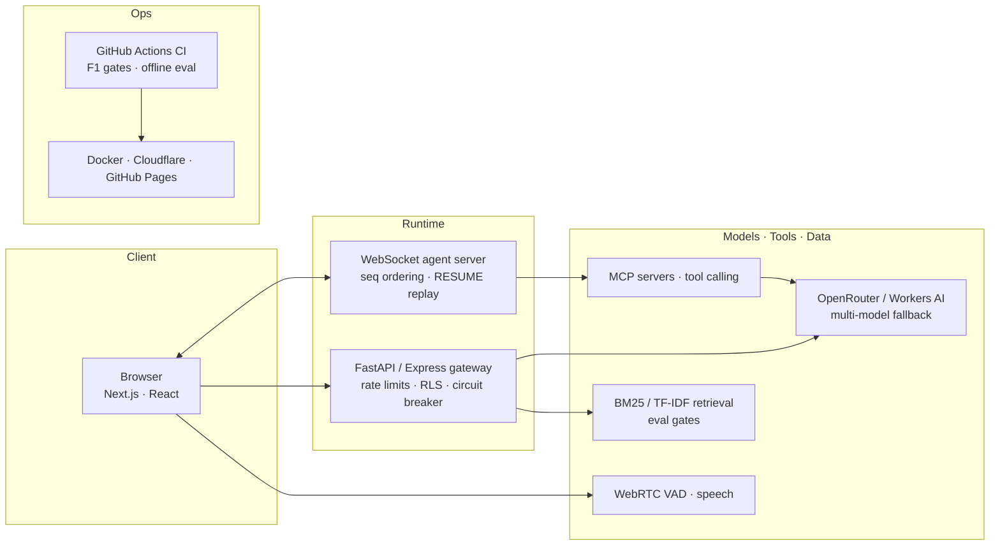

<!-- Profile README · Apple-clean · charcoal on #f5f5f7 / near-black · Nov 2026 -->

<p align="center">
  <picture>
    <source media="(prefers-color-scheme: dark)" srcset="https://raw.githubusercontent.com/mangeshraut712/mangeshraut712/main/banner-dark.svg?v=2026110206" />
    <source media="(prefers-color-scheme: light)" srcset="https://raw.githubusercontent.com/mangeshraut712/mangeshraut712/main/banner-light.svg?v=2026110206" />
    
  </picture>
</p>

> [!IMPORTANT]
> **Open to Software Engineer roles (Pune · Philadelphia · remote).** Portfolio systems: real-time speech VAD with an F1 gate, offline RAG eval, agents with tool calling and failure handling, and the full stack around them. Every number below links to the file or CI run that produced it — stub metrics are labelled stub.
>
> Fastest contact: [mbr63drexel@gmail.com](mailto:mbr63drexel@gmail.com)

<p align="center">
  <a href="https://mangeshraut712.github.io/mangeshrautarchive/"></a>
  <a href="https://www.linkedin.com/in/mangeshraut71298/"></a>
  <a href="https://www.instagram.com/mangesh_d_charming_guy/"></a>
  <a href="https://wa.me/917276819090"></a>
  <a href="https://x.com/mrcommando712"></a>
  <a href="mailto:mbr63drexel@gmail.com"></a>
</p>

<p align="center">
  <a href="https://github.com/sponsors/mangeshraut712"></a>
  <a href="https://buy.stripe.com/14A3cufGUgcV5ePfuA14401"></a>
  <a href="https://www.paypal.com/ncp/payment/LXNHJ5SUGNP82"></a>
  <a href="https://www.buymeacoffee.com/mangeshraut"></a>
</p>

---

### Start here — three systems, end to end

| Project | What it proves | Guardrails | Proof |
| --- | --- | --- | --- |
| [**ai-ml-portfolio**](https://github.com/mangeshraut712/ai-ml-portfolio) — speech VAD + RAG eval + NumPy ML from scratch | Measured VAD F1 gates (real audio + synthetic labels). Offline RAG/LLM eval with retrieval metrics; CI uses **stub** providers | Acceptance gate fails CI below fixed thresholds; eval falls back to stubs when keys are missing | [MODEL_CARD](https://github.com/mangeshraut712/ai-ml-portfolio/blob/main/labs/vad/MODEL_CARD.md) · [RESULTS](https://github.com/mangeshraut712/ai-ml-portfolio/blob/main/labs/llm-eval/RESULTS.md) |
| [**agent-console**](https://github.com/mangeshraut712/agent-console) — real-time agent debug UI over WebSocket | Streaming tokens, tool-call traces, protocol observability | Seq reorder + dedupe, `RESUME {last_seq}` replay, single-fire `TOOL_ACK`, chaos verify | [DECISIONS.md](https://github.com/mangeshraut712/agent-console/blob/main/DECISIONS.md) · [Pages replay demo](https://mangeshraut712.github.io/agent-console/) |
| [**Gravity-SaaS-Agent**](https://github.com/mangeshraut712/Gravity-SaaS-Agent) — multi-tenant agent SaaS starter | MCP client, skills engine, billing events, operator dashboard | Tier rate limits, Supabase RLS, circuit breaker, OpenRouter fallback. Channel adapters are **simulators**, not live Business API | [README](https://github.com/mangeshraut712/Gravity-SaaS-Agent#readme) · [CI](https://github.com/mangeshraut712/Gravity-SaaS-Agent/actions/workflows/ci.yml) |

**Reproduce the headline number** (Python 3.10–3.12, no API keys):

```bash
git clone https://github.com/mangeshraut712/ai-ml-portfolio && cd ai-ml-portfolio
make install && make verify-all      # mlfs tests + VAD FULL_PASS + offline LLM eval
```

---

### Engineering metrics — measured, with baselines and a failure case

<p align="center">
  <picture>
    <source media="(prefers-color-scheme: dark)" srcset="https://raw.githubusercontent.com/mangeshraut712/mangeshraut712/main/metrics-dark.svg?v=202611020605" />
    <source media="(prefers-color-scheme: light)" srcset="https://raw.githubusercontent.com/mangeshraut712/mangeshraut712/main/metrics-light.svg?v=202611020605" />
    
  </picture>
</p>

Headline on the card: VAD clean F1 **0.9569**, VAD p95 **~19 ms** (gate ≤100 ms), CI Python **3.10–3.12**. Detail the card does not show:

| Metric | Measured | Gate / baseline | Source |
| --- | ---: | ---: | --- |
| VAD exact F1, noisy — **known failure mode** | **0.7768** | ≥ 0.75 (clean ≥ 0.92) | [challenge_pass.py](https://github.com/mangeshraut712/ai-ml-portfolio/blob/main/labs/vad/challenge_pass.py) · [MODEL_CARD](https://github.com/mangeshraut712/ai-ml-portfolio/blob/main/labs/vad/MODEL_CARD.md) |
| VAD soft F1 | **0.8135** | ≥ 0.78 | same |
| RAG retrieval **(offline stub)** — TF-IDF Recall@5 · MRR · nDCG@5 | **1.000 · 0.981 · 0.986** | 40 gold QA + 15 adversarial on 10 FAQ docs. BM25-fusion stub Recall@3 **0.975**. Hallucination 0.000 = stub abstaining | [RESULTS.md](https://github.com/mangeshraut712/ai-ml-portfolio/blob/main/labs/llm-eval/RESULTS.md) (STUB, 2026-07-24) · [DATA_CARD](https://github.com/mangeshraut712/ai-ml-portfolio/blob/main/labs/llm-eval/DATA_CARD.md) |
| Stub cost / latency matrix | p95 ms and $/1k queries per **stub** provider | live path is `EVAL_LIVE=1`; CI never sets it | same RESULTS.md |
| CI run for `make verify-all` | green | — | [Sep 11, 2026](https://github.com/mangeshraut712/ai-ml-portfolio/actions/runs/34574401205) |

---

### Open-source contributions

**29 / 50 tracked-company GitHub PR merges** as of **2026-11-02 (UTC)**.<br>
Scoreboard: tip-15 (Apple · Meta · Anthropic · OpenAI · Netflix · Microsoft · Tesla · SpaceX/xAI · Samsung · LG · Walmart · JPMorgan · Amazon/AWS · Adobe · NVIDIA) **plus** Google · Moonshot/Kimi · Sarvam AI.<br>
The goal counts upstream PRs with GitHub `merged=true`; own repositories, duplicate records, and closed-unmerged PRs are excluded. November 2026 merges so far: **2** ([meta/lexical#9707](https://github.com/meta/lexical/pull/9707), [microsoft/physical-ai-toolchain#2075](https://github.com/microsoft/physical-ai-toolchain/pull/2075)). Need **21 more** by **EOD 31 Dec 2026 IST**. Roojool and other non-allowlist orgs do not count.<br>
**14 [Meta Pyrefly](https://github.com/meta/pyrefly) CodeSync landings** on `main` are separately verified as of **2026-10-30 (UTC)**. Their associated GitHub PRs are closed with `merged=false`, so they are not included in the 29.

Live search sample: `author:mangeshraut712 is:pr is:merged -user:mangeshraut712 -user:dayx61 -org:Roojool` (then filter to the allowlist).

```text
29 / 50  ███████████▌░░░░░░░░  58%
```

#### By organization (allowlist scoreboard)

| Org | GitHub merged | Focus |
| --- | ---: | --- |
| [Apple](https://github.com/apple/password-manager-resources) | 7 | Password-manager resources & schema |
| [Microsoft](https://github.com/microsoft) | 5 | hve-core + winget-pkgs + physical-ai-toolchain |
| [Adobe](https://github.com/adobe/react-spectrum) | 2 | React Aria / Spectrum (incl. ColorField Form validation) |
| [AWS Labs](https://github.com/awslabs/mcp) | 4 | MCP, Stickler & billing-cost fixes |
| [NVIDIA](https://github.com/NVIDIA/TensorRT-Model-Connect) | 4 | CUDA Python tests & TensorRT tooling/CI |
| [Sarvam AI](https://github.com/sarvamai/sarvam-ai-cookbook) | 2 | Cookbook CI |
| [OpenAI](https://github.com/openai/codex-security) | 1 | codex-security CLI guidance |
| [Google](https://github.com/google/sbsim) | 1 | sbsim BUILD cleanup |
| [Moonshot](https://github.com/MoonshotAI/kimi-code) | 1 | kimi-code models.dev fallback |
| [Samsung](https://github.com/Samsung/CredSweeper) | 1 | CredSweeper install-guide docs |
| [Meta](https://github.com/meta/lexical) | 1 | Lexical; plus 14 accepted Pyrefly CodeSync landings on `main` (separate) |
| Anthropic · Netflix · Tesla · SpaceX/xAI · LG · Walmart · JPMorgan | 0 | — |

#### Open upstream PRs (allowlist orgs)

97 open as of 2026-11-02, grouped by company.

<details><summary>Amazon/AWS — 24 open</summary>

- [awslabs/dynein#302](https://github.com/awslabs/dynein/pull/302) fix: set GSI capacity when switching a table to provisioned mode
- [awslabs/mcp#4829](https://github.com/awslabs/mcp/pull/4829) fix(postgres-mcp-server): accept username-only secret for PG_WIRE_IAM_PROTOCOL
- [awslabs/mcp#4838](https://github.com/awslabs/mcp/pull/4838) fix(iam-mcp-server): inject ctx instead of requiring it
- [awslabs/mcp#4846](https://github.com/awslabs/mcp/pull/4846) fix(postgres-mcp-server): avoid binding PG-wire connection to a closed event loop
- [awslabs/mcp#4848](https://github.com/awslabs/mcp/pull/4848) fix(aws-api-mcp-server): hide call_aws when AUTH_TYPE=no-auth
- [awslabs/mcp#4850](https://github.com/awslabs/mcp/pull/4850) fix(security): confine start_security_scan paths to the workspace
- [awslabs/mcp#4852](https://github.com/awslabs/mcp/pull/4852) fix(aws-healthomics-mcp-server): compute returnedCount from known result-list keys
- [awslabs/mcp#4853](https://github.com/awslabs/mcp/pull/4853) fix(aws-healthomics-mcp-server): correct no-token partial-results recovery guidance
- [awslabs/mcp#4854](https://github.com/awslabs/mcp/pull/4854) fix(amazon-neptune-mcp-server): respect FASTMCP_LOG_LEVEL for stderr logging
- [awslabs/mcp#4864](https://github.com/awslabs/mcp/pull/4864) fix(stepfunctions-tool-mcp-server): paginate list_state_machines
- [awslabs/stickler#455](https://github.com/awslabs/stickler/pull/455) fix(454): coerce document_files keys and paths in the gallery
- [awslabs/stickler#474](https://github.com/awslabs/stickler/pull/474) fix(report): colour executive summary cards and read document_count
- [awslabs/visual-asset-management-system#842](https://github.com/awslabs/visual-asset-management-system/pull/842) fix(authz): validate constraint list REGEX values element-wise
- [awslabs/visual-asset-management-system#843](https://github.com/awslabs/visual-asset-management-system/pull/843) fix(assets): sanitize SNS topic name for dotted asset IDs
- [awslabs/visual-asset-management-system#845](https://github.com/awslabs/visual-asset-management-system/pull/845) fix(cli): truncate auto-paginate pages to --max-items
- [awslabs/visual-asset-management-system#848](https://github.com/awslabs/visual-asset-management-system/pull/848) fix(cli): fail token-override login when auth errors are wrapped
- [awslabs/visual-asset-management-system#852](https://github.com/awslabs/visual-asset-management-system/pull/852) fix(tests): unify auth module objects across import paths
- [awslabs/visual-asset-management-system#856](https://github.com/awslabs/visual-asset-management-system/pull/856) fix(assetLinks): verify GSI hits before rejecting recreate (#840)
- [awslabs/visual-asset-management-system#857](https://github.com/awslabs/visual-asset-management-system/pull/857) fix(metadata-schema): return 400 when nested fields missing; align CLI create example
- [awslabs/visual-asset-management-system#859](https://github.com/awslabs/visual-asset-management-system/pull/859) fix(upload): stop empty Retry after manual part retry limit
- [awslabs/visual-asset-management-system#860](https://github.com/awslabs/visual-asset-management-system/pull/860) fix(search): wire map view query-paginate to the search API
- [awslabs/visual-asset-management-system#861](https://github.com/awslabs/visual-asset-management-system/pull/861) fix(databases): drop soft-deleted sibling when recreating a database
- [awslabs/visual-asset-management-system#862](https://github.com/awslabs/visual-asset-management-system/pull/862) fix(e2e): skip core tag and viewer cases when preconditions are absent
- [awslabs/visual-asset-management-system#962](https://github.com/awslabs/visual-asset-management-system/pull/962) docs(pipelines): describe executingRequestContext as the executing user name

</details>

<details><summary>Adobe — 11 open</summary>

- [adobe/react-spectrum#10841](https://github.com/adobe/react-spectrum/pull/10841) fix: stop CalendarYearPicker from looping at year 9999
- [adobe/react-spectrum#10842](https://github.com/adobe/react-spectrum/pull/10842) fix(useDateSegment): don't crash when 12-hour time has no day period
- [adobe/react-spectrum#10860](https://github.com/adobe/react-spectrum/pull/10860) fix(react-aria-components): inherit CheckboxGroup validationBehavior (#10856)
- [adobe/react-spectrum#10861](https://github.com/adobe/react-spectrum/pull/10861) fix(useNumberField): skip blur commit when input already disabled
- [adobe/react-spectrum#10864](https://github.com/adobe/react-spectrum/pull/10864) fix(useCalendarYearPicker): preserve month when changing years
- [adobe/react-spectrum#10867](https://github.com/adobe/react-spectrum/pull/10867) fix: keep Menu as sole scrollport in Popover MenuTrigger
- [adobe/react-spectrum#10868](https://github.com/adobe/react-spectrum/pull/10868) fix: allow Mod+A to select ComboBox input text while multi-select menu is open
- [adobe/react-spectrum#10869](https://github.com/adobe/react-spectrum/pull/10869) fix(ComboBox): don't commit value on blur when isReadOnly
- [adobe/react-spectrum#10871](https://github.com/adobe/react-spectrum/pull/10871) fix: announce Select options for VoiceOver
- [adobe/react-spectrum#10872](https://github.com/adobe/react-spectrum/pull/10872) fix: batch virtualizer item measurements
- [adobe/spectrum-web-components#6864](https://github.com/adobe/spectrum-web-components/pull/6864) fix(coachmark): localize step count connector

</details>

<details><summary>Anthropic — 11 open</summary>

- [anthropics/anthropic-sdk-python#2039](https://github.com/anthropics/anthropic-sdk-python/pull/2039) fix(bedrock/aws/vertex): raise CredentialsError when credentials missing (#2038)
- [anthropics/anthropic-sdk-python#2041](https://github.com/anthropics/anthropic-sdk-python/pull/2041) fix(tools): include pydantic field errors in beta_tool invalid-args message
- [anthropics/claude-agent-sdk-python#1445](https://github.com/anthropics/claude-agent-sdk-python/pull/1445) fix: split fork transcripts on newline only
- [anthropics/claude-code-action#1821](https://github.com/anthropics/claude-code-action/pull/1821) docs: reference claude_args instead of removed allowed_tools
- [anthropics/claude-code-action#1912](https://github.com/anthropics/claude-code-action/pull/1912) fix: keep structured output available across jobs under workload identity federation
- [anthropics/claude-code-action#1923](https://github.com/anthropics/claude-code-action/pull/1923) fix: reject zero line numbers for inline comments
- [anthropics/claude-code-action#1924](https://github.com/anthropics/claude-code-action/pull/1924) fix: clear SSH signing git config on cleanup
- [anthropics/claude-code-action#1925](https://github.com/anthropics/claude-code-action/pull/1925) fix: pin private-fork PR heads via pull refs
- [anthropics/claude-code-action#1926](https://github.com/anthropics/claude-code-action/pull/1926) fix: keep printable non-ASCII HTML entities
- [anthropics/claude-code-action#1934](https://github.com/anthropics/claude-code-action/pull/1934) fix: restore AGENTS.md from the PR base branch
- [anthropics/claude-code-action#1938](https://github.com/anthropics/claude-code-action/pull/1938) fix: build trigger regex once and drop no-op ternary

</details>

<details><summary>Microsoft — 10 open</summary>

- [microsoft/monaco-editor#5552](https://github.com/microsoft/monaco-editor/pull/5552) fix: recognize regex literals before a ternary colon
- [microsoft/physical-ai-toolchain#2071](https://github.com/microsoft/physical-ai-toolchain/pull/2071) fix(dataviewer): fail closed on incomplete auth; honor CORS wildcards
- [microsoft/physical-ai-toolchain#2074](https://github.com/microsoft/physical-ai-toolchain/pull/2074) fix(deploy): honor delta action_mode when publishing ACT joint targets
- [microsoft/physical-ai-toolchain#2092](https://github.com/microsoft/physical-ai-toolchain/pull/2092) fix(act-inference): fail-closed until full joint state arrives
- [microsoft/physical-ai-toolchain#2093](https://github.com/microsoft/physical-ai-toolchain/pull/2093) fix(gpu-offload): evict oldest replay nonces instead of rejecting
- [microsoft/pyright#11924](https://github.com/microsoft/pyright/pull/11924) Validate functional NamedTuple field types as type expressions
- [microsoft/pyright#11935](https://github.com/microsoft/pyright/pull/11935) Fix undefined variable reporting for deferred annotations (#11890)
- [microsoft/semantic-kernel#14668](https://github.com/microsoft/semantic-kernel/pull/14668) Python: normalize OpenAPI allowlist paths before prefix match
- [microsoft/winappCli#1258](https://github.com/microsoft/winappCli/pull/1258) docs(devtools): explain XAML-only inspect tree, childCount and hiddenByFilter
- [microsoft/winget-pkgs#459052](https://github.com/microsoft/winget-pkgs/pull/459052) Update: OlegDanilov.RapidEnvironmentEditor to 10.0.5

</details>

<details><summary>Google — 9 open</summary>

- [google-gemini/cookbook#1448](https://github.com/google-gemini/cookbook/pull/1448) fix(ci): resolve README notebook links by destination path
- [google-gemini/cookbook#1449](https://github.com/google-gemini/cookbook/pull/1449) fix(ci): number duplicate heading anchors like GitHub
- [google-gemini/cookbook#1453](https://github.com/google-gemini/cookbook/pull/1453) fix(ci): percent-decode section fragments in the link checker
- [google/adk-go#1956](https://github.com/google/adk-go/pull/1956) fix(openaimodel): send executable code parts as text
- [google/adk-go#1980](https://github.com/google/adk-go/pull/1980) fix(llminternal): sanitize streaming tool failures for the model
- [google/adk-go#1983](https://github.com/google/adk-go/pull/1983) fix(openaimodel): refuse non-function Tool fields genai adds
- [google/adk-python#7763](https://github.com/google/adk-python/pull/7763) fix(apigee): coerce non-object tool-call JSON args to empty dict
- [google/adk-python#7769](https://github.com/google/adk-python/pull/7769) fix(a2a): use final text when finish_task has no call args
- [google/libultrahdr#511](https://github.com/google/libultrahdr/pull/511) fix(decoder): reject zero-length image in uhdr_dec_set_image

</details>

<details><summary>Moonshot/Kimi — 8 open</summary>

- [MoonshotAI/kimi-code#2508](https://github.com/MoonshotAI/kimi-code/pull/2508) fix(kosong): skip empty OpenAI-compatible reasoning stream values
- [MoonshotAI/kimi-code#2510](https://github.com/MoonshotAI/kimi-code/pull/2510) fix(cli): make WSL image paste use PowerShell STA + PNG format
- [MoonshotAI/kimi-code#2511](https://github.com/MoonshotAI/kimi-code/pull/2511) fix(agent-core): refuse multi-line empty Edit deletions
- [MoonshotAI/kimi-code#2515](https://github.com/MoonshotAI/kimi-code/pull/2515) fix(cli): clarify agent help and document -r session alias
- [MoonshotAI/kimi-code#2516](https://github.com/MoonshotAI/kimi-code/pull/2516) fix(agent-core-v2): redact Unicode, UNC, and C:/ paths in telemetry
- [MoonshotAI/kimi-code#4047](https://github.com/MoonshotAI/kimi-code/pull/4047) fix(transcript): keep prompt-hook notes from opening a turn
- [MoonshotAI/kimi-code#4185](https://github.com/MoonshotAI/kimi-code/pull/4185) fix(agent-core-v2): treat escaped glob wildcards as literals
- [MoonshotAI/kimi-code#4433](https://github.com/MoonshotAI/kimi-code/pull/4433) fix(vis): ignore legacy tool-triggered swarm_mode.enter in projector

</details>

<details><summary>Meta — 7 open</summary>

- [meta/lexical-ios#85](https://github.com/meta/lexical-ios/pull/85) docs: document ElementNode methods in DocC
- [meta/pyrefly#4737](https://github.com/meta/pyrefly/pull/4737) feat(lsp): complete closing triple-quoted strings
- [meta/pyrefly#5392](https://github.com/meta/pyrefly/pull/5392) Report redefined instance attributes across methods
- [meta/pyrefly#5417](https://github.com/meta/pyrefly/pull/5417) fix(enums): reject incompatible Enum value-lookup arguments
- [meta/pyrefly#5423](https://github.com/meta/pyrefly/pull/5423) fix(binding): treat object.__setattr__/setattr as instance init
- [meta/pyrefly#5424](https://github.com/meta/pyrefly/pull/5424) fix(solver): keep explicit positional params under gradual *args/**kwargs
- [meta/pyrefly#5425](https://github.com/meta/pyrefly/pull/5425) Diagnose instance methods missing a positional receiver

</details>

<details><summary>Sarvam AI — 6 open</summary>

- [sarvamai/llm_intent_entity#11](https://github.com/sarvamai/llm_intent_entity/pull/11) fix: look up cached evaluations by key
- [sarvamai/llm_intent_entity#12](https://github.com/sarvamai/llm_intent_entity/pull/12) fix: give intent-entity evaluation a finite LLM timeout
- [sarvamai/llm_wer#7](https://github.com/sarvamai/llm_wer/pull/7) fix: ask the WER judge for the equivalent field the schema reads
- [sarvamai/sarvam-ai-cookbook#183](https://github.com/sarvamai/sarvam-ai-cookbook/pull/183) fix(ci): scan notebooks that start with a UTF-8 BOM
- [sarvamai/sarvam-ai-cookbook#184](https://github.com/sarvamai/sarvam-ai-cookbook/pull/184) fix(ci): check added lines against the Sarvam model allowlist
- [sarvamai/skills#5](https://github.com/sarvamai/skills/pull/5) fix(skills): prefer sarvam-105b and drop stale mcp code tool refs

</details>

<details><summary>NVIDIA — 2 open</summary>

- [NVIDIA/cuda-python#3240](https://github.com/NVIDIA/cuda-python/pull/3240) fix(ci): print lychee failure URLs in the job log
- [NVIDIA/cuda-rust#1644](https://github.com/NVIDIA/cuda-rust/pull/1644) docs(cutile): LoadTileLike zero-pads undersized inputs

</details>

<details><summary>Netflix — 2 open</summary>

- [Netflix/vmaf#1712](https://github.com/Netflix/vmaf/pull/1712) fix(cli): pass long-opt ids into parse_unsigned for threads/subsample/cpumask
- [Netflix/zuul#2228](https://github.com/Netflix/zuul/pull/2228) Document that framing enforcement depends on header validation

</details>

<details><summary>OpenAI — 2 open</summary>

- [openai/openai-cookbook#3229](https://github.com/openai/openai-cookbook/pull/3229) Fix Bedrock prompt caching example for a repeated prefix
- [openai/openai-cookbook#3246](https://github.com/openai/openai-cookbook/pull/3246) Fix github_issues investigator accepting a stale investigation.md

</details>

<details><summary>Apple — 1 open</summary>

- [apple/container#2425](https://github.com/apple/container/pull/2425) Normalize legacy short image names so rebuilds replace them

</details>

<details><summary>Tesla — 1 open</summary>

- [teslamotors/fixed-containers#249](https://github.com/teslamotors/fixed-containers/pull/249) \[FixedVector/FixedDeque\] Preserve elements for empty range operations

</details>

<details><summary>Walmart — 1 open</summary>

- [walmartlabs/lacinia#478](https://github.com/walmartlabs/lacinia/pull/478) docs: fix spelling typos (occurred, preferred, overridden, separately)

</details>

<details><summary>LG (webOS OSE) — 1 open</summary>

- [webosose/ares-cli#110](https://github.com/webosose/ares-cli/pull/110) fix(schema): correct 'can be occured' in requiredMemory description

</details>

<details><summary>SpaceX/xAI — 1 open</summary>

- [xai-org/x-algorithm#265](https://github.com/xai-org/x-algorithm/pull/265) fix(phoenix): reject ragged SID snapshot rows

</details>

#### Selected Engineering Impact

- [AWS Labs Stickler #456](https://github.com/awslabs/stickler/pull/456) — Escaped formatted report-cell output and added regression coverage for the affected display paths.
- [Adobe React Spectrum #10863](https://github.com/adobe/react-spectrum/pull/10863) — Made `ColorField` inherit a parent `Form`’s `validationBehavior`, with regression coverage.
- [NVIDIA cuda-python #3241](https://github.com/NVIDIA/cuda-python/pull/3241) — Restored SIGINT handling in the keyboard-interrupt child test.

---

### More projects

Flagship systems stay in **Start here**. Everything else:

<p align="center">
  <picture>
    <source media="(prefers-color-scheme: dark)" srcset="https://raw.githubusercontent.com/mangeshraut712/mangeshraut712/main/projects-dark.svg?v=20261030-claims" />
    <source media="(prefers-color-scheme: light)" srcset="https://raw.githubusercontent.com/mangeshraut712/mangeshraut712/main/projects-light.svg?v=20261030-claims" />
    
  </picture>
</p>

**Also:** [**Actions Nurse**](https://github.com/mangeshraut712/actions-nurse) — Open Agent Hackathon 2026 Wildcard (submitted 28 Oct 2026 4:30 AM IST, [hub](https://hackathon.genai.works/submissions?hackathon_id=019fd164-82b9-7382-a536-d9093c576ed2)). CI triage agent: Rules + optional Gemma, Meterless H-MEM, Zetaris evidence. [submission stamp](https://github.com/mangeshraut712/actions-nurse/blob/main/docs/OPEN-AGENT-SUBMISSION.md).

**Also:** [**Asset Intelligence Copilot**](https://github.com/mangeshraut712/asset-intelligence-copilot) — FlytBase challenge entry (AI Hackers Collective × Hacktoberfest 2026 Hack Day). Chat copilot for oil-field operators: deterministic tools compute numbers, answers cite record IDs and SOP passages, Gemma 4 for planning/phrasing. Local; MIT.

---

<details>
<summary><b>Architecture</b> — patterns across these projects</summary>



</details>

<details>
<summary><b>AI engineering stack</b> — every claim points at a dependency file</summary>

<p align="center">
  <picture>
    <source media="(prefers-color-scheme: dark)" srcset="https://raw.githubusercontent.com/mangeshraut712/mangeshraut712/main/stack-dark.svg?v=20261030-claims" />
    <source media="(prefers-color-scheme: light)" srcset="https://raw.githubusercontent.com/mangeshraut712/mangeshraut712/main/stack-light.svg?v=20261030-claims" />
    
  </picture>
</p>

The card lists tools I use. **Only the dependency manifests below are claims about these repos.**

| Stack claim | Source |
| --- | --- |
| NumPy · webrtcvad · rank-bm25 · scikit-learn | [ai-ml-portfolio/pyproject.toml](https://github.com/mangeshraut712/ai-ml-portfolio/blob/main/pyproject.toml) |
| Next.js 16.4.3 · React 19.1 · Turbopack | [agent-console/package.json](https://github.com/mangeshraut712/agent-console/blob/main/package.json) |
| Next.js 15.5 · React 19.2 · Cloudflare Workers AI | [Hindai/package.json](https://github.com/mangeshraut712/Hindai/blob/main/package.json) · [workers/hindai-gemma](https://github.com/mangeshraut712/Hindai/tree/main/workers) |
| Next.js 16.4 dashboard · Express gateway · Supabase | [Gravity-SaaS-Agent/apps](https://github.com/mangeshraut712/Gravity-SaaS-Agent/tree/main/apps) |
| FastAPI | [mangeshrautarchive/requirements.txt](https://github.com/mangeshraut712/mangeshrautarchive/blob/main/requirements.txt) · [career-agent-pro/backend](https://github.com/mangeshraut712/career-agent-pro/blob/main/backend/requirements.txt) |
| Sarvam SDK | [Realtime_Speech_Captioning/requirements.txt](https://github.com/mangeshraut712/sarvam-ai-cookbook/blob/main/examples/Realtime_Speech_Captioning/requirements.txt) |

</details>

<details>
<summary><b>Now</b> — what I'm building this quarter</summary>

<p align="center">
  <picture>
    <source media="(prefers-color-scheme: dark)" srcset="https://raw.githubusercontent.com/mangeshraut712/mangeshraut712/main/focus-dark.svg?v=20261030-claims" />
    <source media="(prefers-color-scheme: light)" srcset="https://raw.githubusercontent.com/mangeshraut712/mangeshraut712/main/focus-light.svg?v=20261030-claims" />
    
  </picture>
</p>

</details>

<details>
<summary><b>Principles, writing, trajectory</b></summary>

**Engineering principles**

- Measure everything; ship the gate with the number
- Local-first whenever possible; CI must not depend on a live API
- Reliability over novelty — an agent with guardrails beats a flashier one without
- AI should augment, not obscure, the system
- Developer experience matters; simple systems scale better

Details: [INTERVIEW_NOTES.md](https://github.com/mangeshraut712/ai-ml-portfolio/blob/main/INTERVIEW_NOTES.md)

**Writing**

- [Technical writings RSS](https://mangeshraut712.github.io/mangeshrautarchive/rss.xml)

**Trajectory**

<p align="center">
  <picture>
    <source media="(prefers-color-scheme: dark)" srcset="https://raw.githubusercontent.com/mangeshraut712/mangeshraut712/main/trajectory-dark.svg?v=2026102810" />
    <source media="(prefers-color-scheme: light)" srcset="https://raw.githubusercontent.com/mangeshraut712/mangeshraut712/main/trajectory-light.svg?v=2026102810" />
    
  </picture>
</p>

<p align="center">
  <a href="https://github.com/mangeshraut712?tab=overview&from=2021-01-01&to=2026-12-31">Contribution graph</a>
  ·
  <a href="https://github.com/mangeshraut712/mangeshraut712/blob/main/data/github-snapshot.json">yearly snapshot JSON</a>
</p>

</details>

