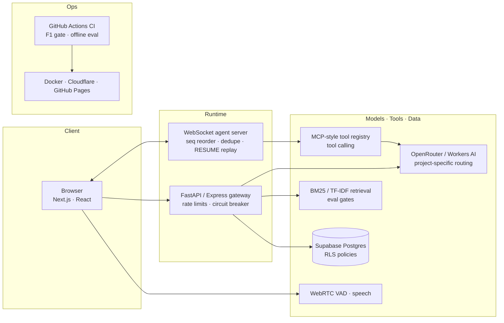
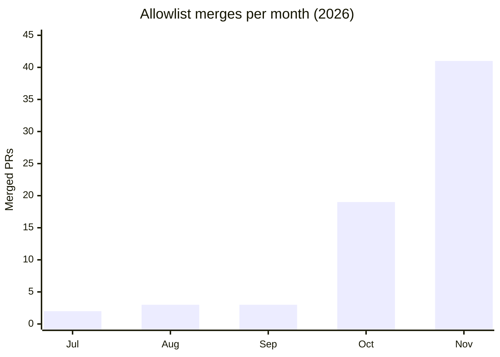

<!-- Profile README · Apple-clean · charcoal on #f5f5f7 / near-black · Nov 2026 -->

<p align="center">
  <picture>
    <source media="(prefers-color-scheme: dark)" srcset="https://raw.githubusercontent.com/mangeshraut712/mangeshraut712/main/banner-dark.svg?v=2026111403" />
    <source media="(prefers-color-scheme: light)" srcset="https://raw.githubusercontent.com/mangeshraut712/mangeshraut712/main/banner-light.svg?v=2026111403" />
    
  </picture>
</p>

> [!IMPORTANT]
> **Open to Software Engineer roles (Pune · Philadelphia · remote).** Portfolio systems: real-time speech VAD with an F1 gate, offline RAG eval, agents with tool calling and failure handling, and the full stack around them. Benchmark figures link to their reports or CI runs; account statistics link to dated snapshots. Stub metrics are labelled stub.
>
> Fastest contact: [mbr63drexel@gmail.com](mailto:mbr63drexel@gmail.com)

<p align="center">
  <a href="https://mangeshraut712.github.io/mangeshrautarchive/"></a>
  <a href="https://www.linkedin.com/in/mangeshraut71298/"></a>
  <a href="https://www.instagram.com/mangesh_d_charming_guy/"></a>
  <a href="https://wa.me/917276819090"></a>
  <a href="https://x.com/mrcommando712"></a>
  <a href="mailto:mbr63drexel@gmail.com"></a>
</p>

<p align="center">
  <a href="https://github.com/sponsors/mangeshraut712"></a>
  <a href="https://buy.stripe.com/14A3cufGUgcV5ePfuA14401"></a>
  <a href="https://www.paypal.com/ncp/payment/LXNHJ5SUGNP82"></a>
  <a href="https://www.buymeacoffee.com/mangeshraut"></a>
</p>

---

### Start here — three systems, end to end

| Project | What it proves | Guardrails | Proof |
| --- | --- | --- | --- |
| [**ai-ml-portfolio**](https://github.com/mangeshraut712/ai-ml-portfolio) — speech VAD + RAG eval + NumPy ML from scratch | Measured VAD F1 gates (real audio + synthetic labels). Offline RAG/LLM eval with retrieval metrics; CI uses **stub** providers | Acceptance gate fails CI below fixed thresholds; eval falls back to stubs when keys are missing | [MODEL_CARD](https://github.com/mangeshraut712/ai-ml-portfolio/blob/main/labs/vad/MODEL_CARD.md) · [RESULTS](https://github.com/mangeshraut712/ai-ml-portfolio/blob/main/labs/llm-eval/RESULTS.md) |
| [**agent-console · Incident Desk**](https://github.com/mangeshraut712/agent-console) — seeded on-call investigation + protocol console | Labelled, key-free replay of Northwind incidents; planner/tool trace, verdict and seed-based scorecard | Live-capable Nemotron planner via Nebius (**not executed**); telemetry stays seeded. Original WebSocket reorder/dedupe and `RESUME` console retained | [Agent implementation](https://github.com/mangeshraut712/agent-console/tree/main/src/agent) · [Protocol decisions](https://github.com/mangeshraut712/agent-console/blob/main/DECISIONS.md) · [Pages replay demo](https://mangeshraut712.github.io/agent-console/) |
| [**Gravity-SaaS-Agent**](https://github.com/mangeshraut712/Gravity-SaaS-Agent) — multi-tenant agent SaaS starter | MCP-style simulated tool registry, skills scaffold, billing events, operator dashboard | Tier rate limits, Supabase RLS policies, OpenRouter retries/circuit breaker and labelled echo fallback. Channel adapters are **simulators**, not live Business API | [README](https://github.com/mangeshraut712/Gravity-SaaS-Agent#readme) · [CI](https://github.com/mangeshraut712/Gravity-SaaS-Agent/actions/workflows/ci.yml) |

---

### Engineering metrics — measured, with baselines and a failure case

VAD figures are from the [Sep 11, 2026 CI run](https://github.com/mangeshraut712/ai-ml-portfolio/actions/runs/34574401205) (batch whole-file processing, excluding warmup). RAG figures are offline stubs. [Source audit and verification limits](docs/PROFILE-AUDIT.md).

<p align="center">
  <picture>
    <source media="(prefers-color-scheme: dark)" srcset="https://raw.githubusercontent.com/mangeshraut712/mangeshraut712/main/metrics-dark.svg?v=20261102-readability" />
    <source media="(prefers-color-scheme: light)" srcset="https://raw.githubusercontent.com/mangeshraut712/mangeshraut712/main/metrics-light.svg?v=20261102-readability" />
    
  </picture>
</p>

| Metric | Measured | Gate / baseline | Source |
| --- | ---: | ---: | --- |
| VAD exact F1, noisy — **known failure mode** | **0.7768** | ≥ 0.75 (clean ≥ 0.92) | [challenge_pass.py](https://github.com/mangeshraut712/ai-ml-portfolio/blob/main/labs/vad/challenge_pass.py) · [MODEL_CARD](https://github.com/mangeshraut712/ai-ml-portfolio/blob/main/labs/vad/MODEL_CARD.md) |
| VAD soft F1 | **0.8135** | ≥ 0.78 | same |
| RAG retrieval **(offline stub)** — TF-IDF Recall@5 · MRR · nDCG@5 | **1.000 · 0.981 · 0.986** | 40 gold QA + 15 adversarial on 10 FAQ docs. BM25-fusion stub Recall@3 **0.975**. Hallucination 0.000 = stub abstaining | [RESULTS.md](https://github.com/mangeshraut712/ai-ml-portfolio/blob/main/labs/llm-eval/RESULTS.md) (STUB, 2026-07-24) · [DATA_CARD](https://github.com/mangeshraut712/ai-ml-portfolio/blob/main/labs/llm-eval/DATA_CARD.md) |
| Stub cost / latency matrix | Stub p95 ms and estimated $/1k queries from configured prices/token estimates | live path is `EVAL_LIVE=1`; CI forces `EVAL_LIVE=0` (stub) | same RESULTS.md |
| CI labs + VAD acceptance gate | green | — | [Sep 11, 2026](https://github.com/mangeshraut712/ai-ml-portfolio/actions/runs/34574401205) |

---

### Open-source contributions

```text
99 / 150  █████████████░░░░░░░  66.0%
```

Checked **November 14, 2026**: **99 public external merges** (**68 company-allowlist merges**). [Evidence and scope](data/oss-scoreboard.json). Latest additions: [Salesforce post-action bare transitions](https://github.com/salesforce/agentscript/pull/106) and [AWS stdout restoration after printer failures](https://github.com/awslabs/stickler/pull/551).

#### By company group and open-source organization (allowlist & ecosystem scoreboard)

| Organization / Company | GitHub Owner | Merged | Scope | Repositories & Focus |
| :--- | :--- | ---: | :---: | :--- |
| [Amazon/AWS](https://github.com/awslabs/stickler/pull/474) | `awslabs` | 24 | Target Company | MCP, Stickler, Social Messaging Agent Runtime Toolkit & Visual Asset Management System |
| [Roojool](https://github.com/Roojool/pune-metro-strava/pull/45) | `Roojool` | 13 | External OSS | Pune Metro transit, commuter leagues, Strava burn pacing & route estimators |
| [Microsoft](https://github.com/microsoft/playwright/pull/44030) | `microsoft` | 10 | Target Company | Playwright docs, [Semantic Kernel](https://github.com/microsoft/semantic-kernel/pull/14668), physical-ai-toolchain, hve-core & winget-pkgs |
| [Apple](https://github.com/apple/password-manager-resources/pull/1851) | `apple` | 7 | Target Company | Password-manager resources, auto-fill domain mappings & JSON schemas |
| [Adobe](https://github.com/adobe/react-spectrum/pull/10860) | `adobe` | 6 | Target Company | React Aria / Spectrum: form validation, CheckboxGroup, ComboBox selection & locale dates |
| [Brekkylab](https://github.com/brekkylab/backlot/pull/788) | `brekkylab` | 6 | External OSS | Backlot: media asset ingest, pipeline automation & test suites |
| [NVIDIA](https://github.com/NVIDIA/cuda-python/pull/3241) | `NVIDIA` | 5 | Target Company | CUDA Python test harness & TensorRT tooling/CI integration |
| [Google](https://github.com/google/sbsim/pull/187) | `google` · `google-gemini` | 4 | Target Company | [ADK Go](https://github.com/google/adk-go/pull/1956), sbsim BUILD cleanup & [Gemini cookbook](https://github.com/google-gemini/cookbook/pull/1449) |
| [Eugenio Enko](https://github.com/eugenioenko/ttt/pull/947) | `eugenioenko` | 3 | External OSS | TTT (Terminal Text Tools): terminal stream processing & utility pipelines |
| [Sarvam AI](https://github.com/sarvamai/sarvam-ai-cookbook/pull/185) | `sarvamai` | 2 | Target Company | Sarvam AI Cookbook CI workflows & example execution |
| [FINOS](https://github.com/finos/architecture-as-code/pull/3331) | `finos` | 2 | External Org | Architecture-as-Code schema validation & model export |
| [AMD](https://github.com/amd/gaia/pull/6656) | `amd` | 1 | Target Company | GAIA memory bootstrap confidence parsing |
| [CapSoftware](https://github.com/CapSoftware/Cap/pull/2549) | `CapSoftware` | 1 | External Org | Cap: open-source screen recording & cross-platform audio pipeline |
| [Comcast](https://github.com/Comcast/xCOMPASS/pull/34) | `Comcast` | 1 | Target Company | xCOMPASS contributor-guide navigation & questionnaire links |
| [ESPnet](https://github.com/espnet/espnet/pull/6890) | `espnet` | 1 | External Org | End-to-end speech processing toolkit documentation & build tests |
| [GitHub](https://github.com/github/gitignore/pull/4942) | `github` | 1 | External Org | GitHub official gitignore template definitions |
| [IBM](https://github.com/IBM/alchemy-logging/pull/807) | `IBM` | 1 | Target Company | Alchemy Logging: atomic Go goroutine-ID formatting & width alignment |
| [Maester](https://github.com/maester365/maester/pull/2392) | `maester365` | 1 | External Org | Maester Microsoft 365 security test framework |
| [Meta](https://github.com/meta/lexical/pull/9707) | `meta` | 1 | Target Company | Lexical rich-text editor framework |
| [Moonshot AI](https://github.com/MoonshotAI/kimi-code/pull/2416) | `MoonshotAI` | 1 | Target Company | kimi-code models.dev fallback provider configuration |
| [Netflix](https://github.com/Netflix/dgs-codegen/pull/997) | `Netflix` | 1 | Target Company | DGS codegen Kotlin client generation & Gradle build fixes |
| [OceanBase](https://github.com/oceanbase/powercontext/pull/2009) | `oceanbase` | 1 | External Org | PowerContext distributed database context management |
| [OpenAI](https://github.com/openai/codex-security/pull/754) | `openai` | 1 | Target Company | codex-security CLI error guidance & output clarity |
| [Railtown AI](https://github.com/RailtownAI/railtracks/pull/1684) | `RailtownAI` | 1 | External Org | Railtracks AI runtime monitoring & diagnostics |
| [Salesforce](https://github.com/salesforce/agentscript/pull/106) | `salesforce` | 1 | Target Company | AgentScript post-action transition compiler handoff |
| [Samsung](https://github.com/Samsung/CredSweeper/pull/997) | `Samsung` | 1 | Target Company | CredSweeper credential scanner install-guide documentation |
| [Sentient](https://github.com/existence-master/Sentient/pull/500) | `existence-master` | 1 | External Org | Sentient autonomous agent framework coordination |
| [Walmart](https://github.com/walmartlabs/json-to-simple-graphql-schema/pull/50) | `walmartlabs` | 1 | Target Company | JSON-to-GraphQL CLI compatibility on Node.js 22+ |
| **Total** | **29 Owners / Orgs** | **99** | **68 Goal · 31 Ext** | **28 Repositories across 99 verified merged pull requests** |

#### Selected Engineering Impact

Five case studies selected from those 68 company-allowlist merges. Each links to the merged PR and its tests.

<details open>
<summary><b>Google · ADK-Go: preserve code-execution history across model providers</b></summary>

- **Problem:** Replaying Gemini conversation history through the OpenAI adapter failed when a turn contained executable code or execution output.
- **My contribution:** Converted both part types to labeled, fenced text in the Chat Completions and Responses request paths, preserving their order alongside ordinary text and images.
- **Validation:** Added request-payload regressions for both APIs, including empty code, mixed media and replayed reasoning. [Chat Completions tests](https://github.com/google/adk-go/blob/ded357e351dee44c023398a49d314aa326a59c94/model/openaimodel/internal/completions/request_test.go) · [Responses tests](https://github.com/google/adk-go/blob/ded357e351dee44c023398a49d314aa326a59c94/model/openaimodel/internal/responses/request_test.go).
- **Outcome:** [Merged November 6, 2026 · #1956](https://github.com/google/adk-go/pull/1956). Request conversion preserves the code and its output as context. This does not execute the code or claim live-provider validation.

</details>

<details>
<summary><b>Microsoft · Semantic Kernel: enforce URL allowlists after path normalization</b></summary>

- **Problem:** A raw prefix check let paths such as `/api/../admin` satisfy an `/api` allowlist even though the HTTP client requested `/admin`.
- **My contribution:** Required both raw and percent-decoded paths to pass the allowlist after dot-segment normalization, preserving empty segments and matching httpx's treatment of terminal dot segments.
- **Validation:** Added escaping-path and allowed-path cases, comparisons against httpx's wire path, and runner tests proving rejected targets never invoke authentication or send a request. [Validator tests](https://github.com/microsoft/semantic-kernel/blob/356acb66538a3f0f701a15105304c5c95428e51d/python/tests/unit/connectors/openapi_plugin/test_server_url_validator.py) · [Runner tests](https://github.com/microsoft/semantic-kernel/blob/356acb66538a3f0f701a15105304c5c95428e51d/python/tests/unit/connectors/openapi_plugin/test_openapi_runner.py).
- **Outcome:** [Merged November 2, 2026 · #14668](https://github.com/microsoft/semantic-kernel/pull/14668). The tested traversal and prefix-boundary cases are rejected before outbound work, while valid paths remain accepted.

</details>

<details>
<summary><b>Amazon/AWS · PostgreSQL MCP: keep database connections on the serving event loop</b></summary>

- **Problem:** Startup validation initialized PostgreSQL pool state on a temporary event loop, leaving later MCP tool calls with connections bound to a closed loop.
- **My contribution:** Moved loop-bound startup validation into the MCP server lifespan and added asynchronous cleanup on the same loop, with bounded concurrent connection closes.
- **Validation:** Regression coverage exercises startup validation followed by the first query, registered lifespan cleanup, startup refusal, and failed or stalled connection closes. [Regression tests](https://github.com/awslabs/mcp/blob/730add86aba3bec19f820ae501462059d25af33a/src/postgres-mcp-server/tests/test_server_error_handling.py) · [Cleanup tests](https://github.com/awslabs/mcp/blob/730add86aba3bec19f820ae501462059d25af33a/src/postgres-mcp-server/tests/test_db_connection_map.py).
- **Outcome:** [Merged November 9, 2026 · #4846](https://github.com/awslabs/mcp/pull/4846). Pool initialization, tool use and shutdown share the serving loop; these tests use controlled database doubles, not a live PostgreSQL deployment.

</details>

<details>
<summary><b>IBM · Alchemy Logging: align goroutine IDs in Go log headers</b></summary>

- **Problem:** Pretty-print log headers shifted as goroutine IDs changed digit width, making concurrent logs harder to scan.
- **My contribution:** Added padding to the widest ID seen so far, using atomic updates because header formatting runs under a read lock. Resetting logger defaults clears the recorded width.
- **Validation:** Regression tests cover growing and shrinking ID widths, the emitted log header, and reset behavior. [Regression tests](https://github.com/IBM/alchemy-logging/blob/c22f4d658b2eaa96654a2508cdd0fd8b039d68ca/src/go/alog/alog_test.go).
- **Outcome:** [Merged November 11, 2026 · #807](https://github.com/IBM/alchemy-logging/pull/807). Later headers stay aligned to the widest observed ID; earlier lines are not rewritten.

</details>

<details>
<summary><b>Walmart · JSON-to-GraphQL CLI: restore Node.js 22 compatibility</b></summary>

- **Problem:** The CLI's yargs subpath import failed under Node.js 22+, preventing JSON input from being converted into a GraphQL schema.
- **My contribution:** Switched to the package-root CommonJS export and added a subprocess integration test for the --baseType and --prefix options.
- **Validation:** The test pipes a JSON fixture through the CLI and checks the generated root and prefixed nested type names. [Regression tests](https://github.com/walmartlabs/json-to-simple-graphql-schema/blob/47b855cb101981812f4bebf3cbde44b5488bfe7e/test/integration.spec.js).
- **Outcome:** [Merged November 11, 2026 · #50](https://github.com/walmartlabs/json-to-simple-graphql-schema/pull/50). The CLI uses the compatible yargs entry point while preserving its schema-naming options.

</details>

---

### Developer tools — install and use

| Project | What it does | Install / try | Validation |
| --- | --- | --- | --- |
| [**Codex Insights**](https://github.com/mangeshraut712/codex-insights) | Private HTML/JSON workflow reports from Codex sessions; optional shareable aggregate profile. Local-only mode makes zero model calls. | `npx @mangeshraut712/codex-insights@0.7.0 --local-only` | [115 tests and 20 synthetic CLI/browser journeys](https://github.com/mangeshraut712/codex-insights/pull/23) |
| [**Mangesh’s Merge Guide**](https://github.com/mangeshraut712/mangeshs-merge-guide) | Contribution workflow from issue selection and reproduction through testing, PR review and follow-through. | `npx @mangeshraut712/merge-guide@0.1.0 install --target codex` | [Installer, helper and upgrade-safety checks](https://github.com/mangeshraut712/mangeshs-merge-guide/pull/1) |

npm releases verified **November 13, 2026**. The latest GitHub source includes additional fixes beyond these published versions. For the Insights skill, follow its [plugin installation](https://github.com/mangeshraut712/codex-insights#install-insights) and invoke `$insights`; Merge Guide installs as `$oss-contribution-insights` and also supports Claude Code and Cursor destinations. [Insights source fixes](https://github.com/mangeshraut712/codex-insights/pull/22) · [Merge Guide source fixes](https://github.com/mangeshraut712/mangeshs-merge-guide/pull/1).

---

### More projects

<p align="center">
  <picture>
    <source media="(prefers-color-scheme: dark)" srcset="https://raw.githubusercontent.com/mangeshraut712/mangeshraut712/main/projects-dark.svg?v=20261102-readability" />
    <source media="(prefers-color-scheme: light)" srcset="https://raw.githubusercontent.com/mangeshraut712/mangeshraut712/main/projects-light.svg?v=20261102-readability" />
    
  </picture>
</p>

- [**Actions Nurse**](https://github.com/mangeshraut712/actions-nurse) — Open Agent Hackathon 2026 Wildcard track (author-recorded submission: 28 Oct 2026 4:30 AM IST, [hub](https://hackathon.genai.works/submissions?hackathon_id=019fd164-82b9-7382-a536-d9093c576ed2)). CI triage agent: Rules + optional Gemma, Meterless H-MEM, labelled Zetaris fixtures with optional live read-only evidence. [submission stamp](https://github.com/mangeshraut712/actions-nurse/blob/main/docs/OPEN-AGENT-SUBMISSION.md).

- [**Asset Intelligence Copilot**](https://github.com/mangeshraut712/asset-intelligence-copilot) — FlytBase challenge entry (AI Hackers Collective × Hacktoberfest 2026 Hack Day). Chat copilot for oil-field operators: deterministic tools compute numbers, answers cite record IDs and SOP passages, Gemma 4 for planning/phrasing. Local; MIT.

---

<details>
<summary><b>Architecture</b> — patterns across these projects</summary>

Conceptual patterns across separate projects; arrows do not assert one integrated deployment.



| Pattern | Where it lives | Evidence |
| --- | --- | --- |
| Ordered, deduplicated streaming + `RESUME` | agent-console | [reorderBuffer.ts](https://github.com/mangeshraut712/agent-console/blob/main/src/lib/reorderBuffer.ts) · [tests](https://github.com/mangeshraut712/agent-console/blob/main/src/lib/__tests__/reorderBuffer.test.ts) · [DECISIONS.md](https://github.com/mangeshraut712/agent-console/blob/main/DECISIONS.md) |
| Rate limits + circuit breaker | Gravity-SaaS-Agent gateway | [rate-limiter.ts](https://github.com/mangeshraut712/Gravity-SaaS-Agent/blob/main/apps/gateway/src/services/rate-limiter.ts) · [circuit-breaker.ts](https://github.com/mangeshraut712/Gravity-SaaS-Agent/blob/main/apps/gateway/src/services/circuit-breaker.ts) · [unit tests](https://github.com/mangeshraut712/Gravity-SaaS-Agent/tree/main/tests/unit/gateway) |
| Tenant isolation (RLS) | Gravity-SaaS-Agent | [supabase/schema.sql](https://github.com/mangeshraut712/Gravity-SaaS-Agent/blob/main/supabase/schema.sql) |
| MCP-style tools (**simulated**) | Gravity-SaaS-Agent | [mcp-client](https://github.com/mangeshraut712/Gravity-SaaS-Agent/blob/main/packages/mcp-client/src/index.ts) |
| Workers AI + optional OpenRouter | Hindai | [hindai-gemma worker](https://github.com/mangeshraut712/Hindai/blob/main/workers/hindai-gemma/src/index.ts) |
| CI gates, live APIs off | ai-ml-portfolio | [ci.yml](https://github.com/mangeshraut712/ai-ml-portfolio/blob/main/.github/workflows/ci.yml) (`EVAL_LIVE: "0"`, VAD `challenge_pass.py`) |
| Containers | agent-console · Gravity-SaaS-Agent | [docker-compose.yml](https://github.com/mangeshraut712/agent-console/blob/main/docker-compose.yml) · [docker-compose.yml](https://github.com/mangeshraut712/Gravity-SaaS-Agent/blob/main/docker-compose.yml) |

</details>

<details>
<summary><b>AI engineering stack</b> — tools and dependency evidence</summary>

<p align="center">
  <picture>
    <source media="(prefers-color-scheme: dark)" srcset="https://raw.githubusercontent.com/mangeshraut712/mangeshraut712/main/stack-dark.svg?v=20261102-audit" />
    <source media="(prefers-color-scheme: light)" srcset="https://raw.githubusercontent.com/mangeshraut712/mangeshraut712/main/stack-light.svg?v=20261102-audit" />
    
  </picture>
</p>

The card lists tools I use or explore. **The manifests below verify declared dependencies (checked 2026-11-10), not installed versions or live deployment.**

| Repo | Declared stack | Manifest |
| --- | --- | --- |
| ai-ml-portfolio | NumPy · webrtcvad · librosa · rank-bm25 · scikit-learn | [pyproject.toml](https://github.com/mangeshraut712/ai-ml-portfolio/blob/main/pyproject.toml) |
| agent-console | Next.js 16.4.3 · React 19.1 · TypeScript 5.8 · Turbopack · ws | [package.json](https://github.com/mangeshraut712/agent-console/blob/main/package.json) |
| Hindai | Next.js 15.5 · React 19.2 · Cloudflare Workers AI | [package.json](https://github.com/mangeshraut712/Hindai/blob/main/package.json) · [workers/hindai-gemma](https://github.com/mangeshraut712/Hindai/tree/main/workers/hindai-gemma) |
| Gravity-SaaS-Agent | Next.js 16.4 dashboard · Express 4 gateway · Supabase | [apps](https://github.com/mangeshraut712/Gravity-SaaS-Agent/tree/main/apps) |
| mangeshrautarchive | FastAPI · Uvicorn · Pydantic 2 · httpx | [requirements.txt](https://github.com/mangeshraut712/mangeshrautarchive/blob/main/requirements.txt) |
| career-agent-pro | FastAPI · OpenAI SDK · Pydantic 2 | [backend/requirements.txt](https://github.com/mangeshraut712/career-agent-pro/blob/main/backend/requirements.txt) |
| sarvam-ai-cookbook | Sarvam SDK · Flask-SocketIO · websockets | [Realtime_Speech_Captioning/requirements.txt](https://github.com/mangeshraut712/sarvam-ai-cookbook/blob/main/examples/Realtime_Speech_Captioning/requirements.txt) |

</details>

<details>
<summary><b>Now</b> — what I'm building in Q4 2026</summary>

<p align="center">
  <picture>
    <source media="(prefers-color-scheme: dark)" srcset="https://raw.githubusercontent.com/mangeshraut712/mangeshraut712/main/focus-dark.svg?v=20261102-audit" />
    <source media="(prefers-color-scheme: light)" srcset="https://raw.githubusercontent.com/mangeshraut712/mangeshraut712/main/focus-light.svg?v=20261102-audit" />
    
  </picture>
</p>

| Track | Where | Latest verified status / evidence |
| --- | --- | --- |
| Speech AI / VAD | [ai-ml-portfolio · labs/vad](https://github.com/mangeshraut712/ai-ml-portfolio/tree/main/labs/vad) | CI + VAD FULL_PASS gate green · [Nov 3 run](https://github.com/mangeshraut712/ai-ml-portfolio/actions/runs/41631353871) |
| RAG eval | [ai-ml-portfolio · labs/llm-eval](https://github.com/mangeshraut712/ai-ml-portfolio/tree/main/labs/llm-eval) | Offline stub report; live mode off in CI |
| Agent tooling | [agent-console](https://github.com/mangeshraut712/agent-console) · [actions-nurse](https://github.com/mangeshraut712/actions-nurse) | Incident Desk seeded replay shipped; live Nebius path not executed |
| MCP apps | [Gravity-SaaS-Agent](https://github.com/mangeshraut712/Gravity-SaaS-Agent) · upstream [awslabs/mcp](https://github.com/awslabs/mcp/pull/4846) | Registry simulated · 4 awslabs/mcp merges |
| Developer tools | [Codex Insights](https://github.com/mangeshraut712/codex-insights) · [Merge Guide](https://github.com/mangeshraut712/mangeshs-merge-guide) | npm releases verified; November 13 source fixes merged; Insights synthetic E2E coverage added |
| OSS frameworks | [scoreboard](data/oss-scoreboard.json) | 60 of 68 allowlist merges landed in Q4 |

```text
Q4 2026 allowlist merges   Oct  19  ███████████████████░░░░░░░░░
                           Nov  41  █████████████████████████████████████████  (through Nov 14, IST)
```

</details>

<details>
<summary><b>OSS merge pace</b> — allowlist merges by month</summary>

Merge dates from the [scoreboard](data/oss-scoreboard.json), grouped by IST month. November is partial (through 2026-11-14).



| Repo (top 5) | Merged |
| --- | ---: |
| [awslabs/visual-asset-management-system](https://github.com/awslabs/visual-asset-management-system/pulls?q=is%3Apr+is%3Amerged+author%3Amangeshraut712) | 12 |
| [apple/password-manager-resources](https://github.com/apple/password-manager-resources/pulls?q=is%3Apr+is%3Amerged+author%3Amangeshraut712) | 7 |
| [microsoft/physical-ai-toolchain](https://github.com/microsoft/physical-ai-toolchain/pulls?q=is%3Apr+is%3Amerged+author%3Amangeshraut712) | 6 |
| [adobe/react-spectrum](https://github.com/adobe/react-spectrum/pulls?q=is%3Apr+is%3Amerged+author%3Amangeshraut712) | 6 |
| [awslabs/stickler](https://github.com/awslabs/stickler/pulls?q=is%3Apr+is%3Amerged+author%3Amangeshraut712) | 5 |

</details>

<details>
<summary><b>In review</b> — open upstream pull requests</summary>

[View current open upstream PRs on GitHub](https://github.com/search?q=author%3Amangeshraut712+is%3Apr+is%3Aopen+is%3Apublic+-user%3Amangeshraut712+-user%3Adayx61+-org%3Ahuggingface&type=pullrequests). Review status changes independently of merge counts; use the live list for current feedback and pending work.

</details>

<details>
<summary><b>Principles, writing, trajectory</b></summary>

**Engineering principles** — each one, where it shows up in code

- **Measure everything; ship the gate with the number** — VAD F1 gate runs in [CI](https://github.com/mangeshraut712/ai-ml-portfolio/blob/main/.github/workflows/ci.yml) and fails below threshold
- **Local-first; CI must not depend on a live API** — CI sets `EVAL_LIVE: "0"`; agent-console ships a key-free [replay](https://github.com/mangeshraut712/agent-console/blob/main/src/agent/replay.ts)
- **Reliability over novelty** — tested [circuit breaker](https://github.com/mangeshraut712/Gravity-SaaS-Agent/blob/main/tests/unit/gateway/circuit-breaker.test.ts) and [rate limiter](https://github.com/mangeshraut712/Gravity-SaaS-Agent/blob/main/tests/unit/gateway/rate-limiter.test.ts)
- **AI should augment, not obscure, the system** — Incident Desk shows the planner/tool trace and scorecard ([eval.ts](https://github.com/mangeshraut712/agent-console/blob/main/src/agent/eval.ts))
- **Developer experience matters; simple systems scale better** — `make verify-all` runs the tests, VAD gate and offline eval with no API keys

Details: [INTERVIEW_NOTES.md](https://github.com/mangeshraut712/ai-ml-portfolio/blob/main/INTERVIEW_NOTES.md)

**Writing** — [Technical writings RSS](https://mangeshraut712.github.io/mangeshrautarchive/rss.xml) (20 posts in the feed)

| Date | Latest posts |
| --- | --- |
| Oct 29, 2026 | [Touchscreen MacBook Pro field notes](https://mangeshraut712.github.io/mangeshrautarchive/blog/macbook-pro-touchscreen-proled-xdr-2026.html) |
| Oct 28, 2026 | [Gemini 4 Argon and Carbon field notes](https://mangeshraut712.github.io/mangeshrautarchive/blog/gemini-4-argon-and-carbon-deepmind-2026.html) |
| Sep 29, 2026 | [OpenAI DevDay 2026: models, ongoing agents, reliable workflows](https://mangeshraut712.github.io/mangeshrautarchive/blog/openai-devday-2026.html) |
| Sep 10, 2026 | [Razorpay Vulcan: evaluating a payments foundation model](https://mangeshraut712.github.io/mangeshrautarchive/blog/razorpay-vulcan-payments-foundation-model.html) |

**Trajectory**

<p align="center">
  <picture>
    <source media="(prefers-color-scheme: dark)" srcset="https://raw.githubusercontent.com/mangeshraut712/mangeshraut712/main/trajectory-dark.svg?v=20261102-audit" />
    <source media="(prefers-color-scheme: light)" srcset="https://raw.githubusercontent.com/mangeshraut712/mangeshraut712/main/trajectory-light.svg?v=20261102-audit" />
    
  </picture>
</p>

Figures from the [repository's GitHub snapshot](data/github-snapshot.json), collected **2026-11-13 05:55 IST**:

| 2026 activity | Count |
| --- | ---: |
| Contribution-calendar total | 6,054 |
| Commits | 3,700 |
| Pull requests | 1,640 |
| Reviews | 348 |
| Issues | 264 |

The calendar total and activity-type counts are separate GitHub measures; the rows are not presented as a sum.

<p align="center">
  <a href="https://github.com/mangeshraut712?tab=overview&from=2021-01-01&to=2026-12-31">Contribution graph</a>
  ·
  <a href="https://github.com/mangeshraut712/mangeshraut712/blob/main/data/github-snapshot.json">yearly snapshot JSON</a>
</p>

</details>
