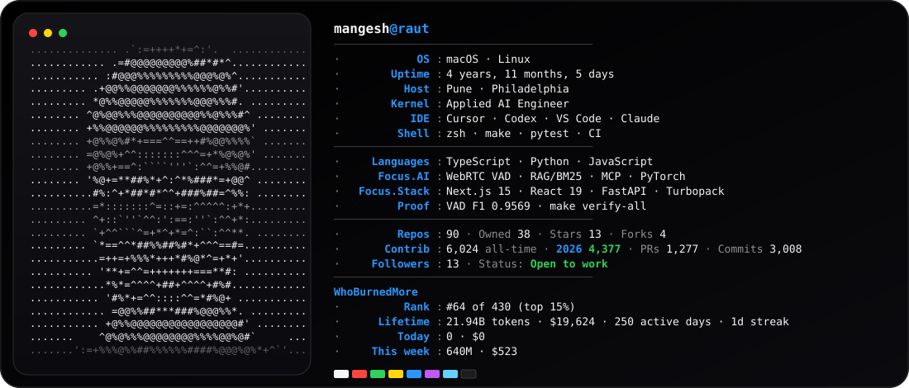
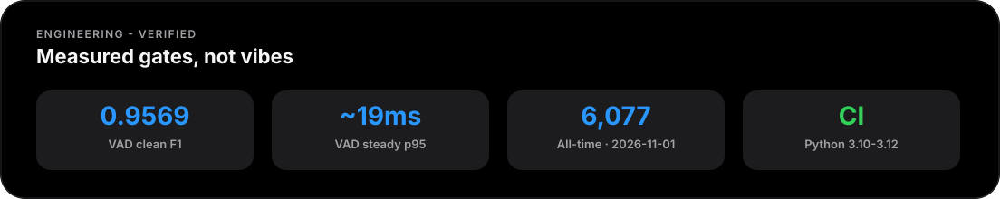
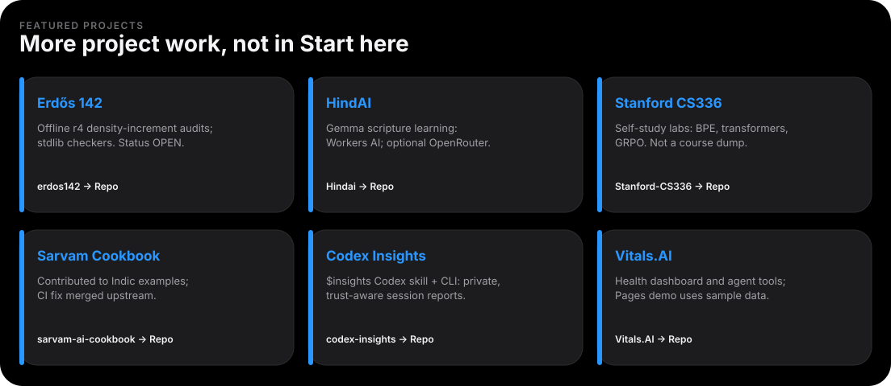
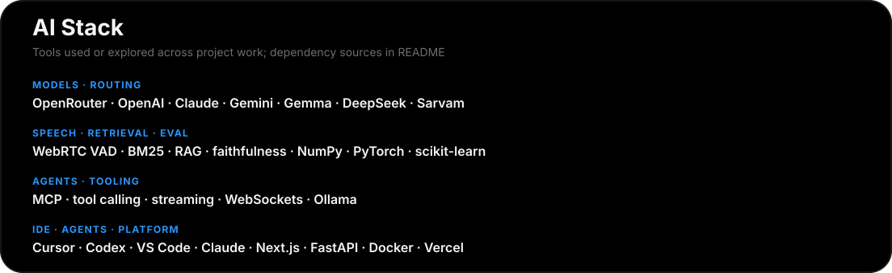
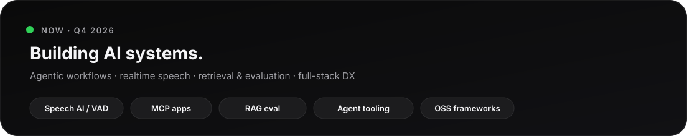
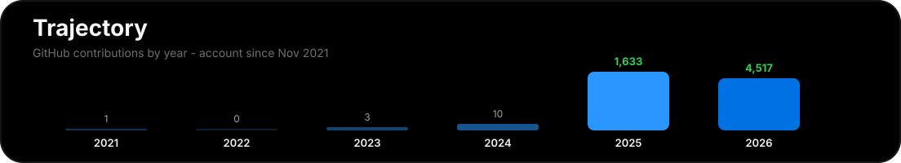

<!-- Profile README · Apple-clean · charcoal on #f5f5f7 / near-black · Nov 2026 -->

<p align="center">
  <picture>
    <source media="(prefers-color-scheme: dark)" srcset="https://raw.githubusercontent.com/mangeshraut712/mangeshraut712/main/banner-dark.svg?v=2026110720" />
    <source media="(prefers-color-scheme: light)" srcset="https://raw.githubusercontent.com/mangeshraut712/mangeshraut712/main/banner-light.svg?v=2026110720" />
    
  </picture>
</p>

> [!IMPORTANT]
> **Open to Software Engineer roles (Pune · Philadelphia · remote).** Portfolio systems: real-time speech VAD with an F1 gate, offline RAG eval, agents with tool calling and failure handling, and the full stack around them. Benchmark figures link to their reports or CI runs; account statistics link to dated snapshots. Stub metrics are labelled stub.
>
> Fastest contact: [mbr63drexel@gmail.com](mailto:mbr63drexel@gmail.com)

<p align="center">
  <a href="https://mangeshraut712.github.io/mangeshrautarchive/"></a>
  <a href="https://www.linkedin.com/in/mangeshraut71298/"></a>
  <a href="https://www.instagram.com/mangesh_d_charming_guy/"></a>
  <a href="https://wa.me/917276819090"></a>
  <a href="https://x.com/mrcommando712"></a>
  <a href="mailto:mbr63drexel@gmail.com"></a>
</p>

<p align="center">
  <a href="https://github.com/sponsors/mangeshraut712"></a>
  <a href="https://buy.stripe.com/14A3cufGUgcV5ePfuA14401"></a>
  <a href="https://www.paypal.com/ncp/payment/LXNHJ5SUGNP82"></a>
  <a href="https://www.buymeacoffee.com/mangeshraut"></a>
</p>

---

### Start here — three systems, end to end

| Project | What it proves | Guardrails | Proof |
| --- | --- | --- | --- |
| [**ai-ml-portfolio**](https://github.com/mangeshraut712/ai-ml-portfolio) — speech VAD + RAG eval + NumPy ML from scratch | Measured VAD F1 gates (real audio + synthetic labels). Offline RAG/LLM eval with retrieval metrics; CI uses **stub** providers | Acceptance gate fails CI below fixed thresholds; eval falls back to stubs when keys are missing | [MODEL_CARD](https://github.com/mangeshraut712/ai-ml-portfolio/blob/main/labs/vad/MODEL_CARD.md) · [RESULTS](https://github.com/mangeshraut712/ai-ml-portfolio/blob/main/labs/llm-eval/RESULTS.md) |
| [**agent-console · Incident Desk**](https://github.com/mangeshraut712/agent-console) — seeded on-call investigation + protocol console | Labelled, key-free replay of Northwind incidents; planner/tool trace, verdict and seed-based scorecard | Live-capable Nemotron planner via Nebius (**not executed**); telemetry stays seeded. Original WebSocket reorder/dedupe and `RESUME` console retained | [Agent implementation](https://github.com/mangeshraut712/agent-console/tree/main/src/agent) · [Protocol decisions](https://github.com/mangeshraut712/agent-console/blob/main/DECISIONS.md) · [Pages replay demo](https://mangeshraut712.github.io/agent-console/) |
| [**Gravity-SaaS-Agent**](https://github.com/mangeshraut712/Gravity-SaaS-Agent) — multi-tenant agent SaaS starter | MCP-style simulated tool registry, skills scaffold, billing events, operator dashboard | Tier rate limits, Supabase RLS policies, OpenRouter retries/circuit breaker and labelled echo fallback. Channel adapters are **simulators**, not live Business API | [README](https://github.com/mangeshraut712/Gravity-SaaS-Agent#readme) · [CI](https://github.com/mangeshraut712/Gravity-SaaS-Agent/actions/workflows/ci.yml) |

**Run the benchmark and acceptance gates** (Python 3.10–3.12, no API keys; latency depends on hardware):

```bash
git clone https://github.com/mangeshraut712/ai-ml-portfolio && cd ai-ml-portfolio
make install && make verify-all      # mlfs tests + VAD FULL_PASS + offline LLM eval
```

On Debian/Ubuntu, install `build-essential` and `libsndfile1` first. Initial setup needs network access for dependencies and audio.

---

### Engineering metrics — measured, with baselines and a failure case

[Source audit and verification limits](docs/PROFILE-AUDIT.md) · checked November 3, 2026.

<p align="center">
  <picture>
    <source media="(prefers-color-scheme: dark)" srcset="https://raw.githubusercontent.com/mangeshraut712/mangeshraut712/main/metrics-dark.svg?v=20261102-readability" />
    <source media="(prefers-color-scheme: light)" srcset="https://raw.githubusercontent.com/mangeshraut712/mangeshraut712/main/metrics-light.svg?v=20261102-readability" />
    
  </picture>
</p>

The VAD figures come from Sep 11, 2026 CI. Latency measures batch whole-file processing and excludes warmup; the VAD gate runs on Python 3.11. Exact labels are constructed from real speech and synthetic silence; soft labels use energy, not human annotation. Baselines and failure cases:

| Metric | Measured | Gate / baseline | Source |
| --- | ---: | ---: | --- |
| VAD exact F1, noisy — **known failure mode** | **0.7768** | ≥ 0.75 (clean ≥ 0.92) | [challenge_pass.py](https://github.com/mangeshraut712/ai-ml-portfolio/blob/main/labs/vad/challenge_pass.py) · [MODEL_CARD](https://github.com/mangeshraut712/ai-ml-portfolio/blob/main/labs/vad/MODEL_CARD.md) |
| VAD soft F1 | **0.8135** | ≥ 0.78 | same |
| RAG retrieval **(offline stub)** — TF-IDF Recall@5 · MRR · nDCG@5 | **1.000 · 0.981 · 0.986** | 40 gold QA + 15 adversarial on 10 FAQ docs. BM25-fusion stub Recall@3 **0.975**. Hallucination 0.000 = stub abstaining | [RESULTS.md](https://github.com/mangeshraut712/ai-ml-portfolio/blob/main/labs/llm-eval/RESULTS.md) (STUB, 2026-07-24) · [DATA_CARD](https://github.com/mangeshraut712/ai-ml-portfolio/blob/main/labs/llm-eval/DATA_CARD.md) |
| Stub cost / latency matrix | Stub p95 ms and estimated $/1k queries from configured prices/token estimates | live path is `EVAL_LIVE=1`; CI forces `EVAL_LIVE=0` (stub) | same RESULTS.md |
| CI labs + VAD acceptance gate | green | — | [Sep 11, 2026](https://github.com/mangeshraut712/ai-ml-portfolio/actions/runs/34574401205) |

---

### Open-source contributions

```text
51 / 75  ██████████████░░░░░░  68%
```

**51 merged pull requests** across 13 company groups on my allowlist, verified **2026-11-07**. The original 50-PR milestone is complete; the next goal is **75**, with **24 to go**.

[All 51 merged PRs and merge dates](data/oss-scoreboard.json) · GitHub-merged PRs only; CodeSync landings are tracked separately. **82 public external PRs merged overall**, including the 51 on this allowlist ([search](https://github.com/search?q=author%3Amangeshraut712+is%3Apr+is%3Amerged+-user%3Amangeshraut712+is%3Apublic&type=pullrequests)).

#### By company group (allowlist scoreboard)

| Company group | Merged | Focus |
| --- | ---: | --- |
| [Meta](https://github.com/meta/lexical/pull/9707) | 1 | Lexical |
| [Amazon/AWS](https://github.com/awslabs/visual-asset-management-system/pull/856) | 15 | MCP, Stickler, billing-cost fixes & Visual Asset Management System |
| [Microsoft](https://github.com/microsoft/physical-ai-toolchain/pull/2093) | 8 | hve-core, winget-pkgs, physical-ai-toolchain, [Semantic Kernel](https://github.com/microsoft/semantic-kernel/pull/14668) |
| [Apple](https://github.com/apple/password-manager-resources/pull/1851) | 7 | Password-manager resources & schema |
| [NVIDIA](https://github.com/NVIDIA/cuda-python/pull/3241) | 5 | CUDA Python tests & TensorRT tooling/CI |
| [Adobe](https://github.com/adobe/react-spectrum/pull/10860) | 4 | React Aria / Spectrum (incl. ColorField Form validation & CheckboxGroup validation behavior) |
| [Sarvam AI](https://github.com/sarvamai/sarvam-ai-cookbook/pull/185) | 2 | Cookbook CI |
| [Google](https://github.com/google/sbsim/pull/187) | 4 | sbsim BUILD cleanup + [Gemini cookbook](https://github.com/google-gemini/cookbook/pull/1449) link checker + [ADK Go](https://github.com/google/adk-go/pull/1983) function-tool validation + [ADK Go executable code parts](https://github.com/google/adk-go/pull/1956) |
| [OpenAI](https://github.com/openai/codex-security/pull/754) | 1 | codex-security CLI guidance |
| [Netflix](https://github.com/Netflix/dgs-codegen/pull/997) | 1 | DGS codegen Kotlin client generation |
| [Samsung](https://github.com/Samsung/CredSweeper/pull/997) | 1 | CredSweeper install-guide docs |
| [Moonshot AI](https://github.com/MoonshotAI/kimi-code/pull/2416) | 1 | kimi-code models.dev fallback |
| [AMD](https://github.com/amd/gaia/pull/6656) | 1 | GAIA memory bootstrap confidence parsing |

Google combines `google` and `google-gemini`; each PR is counted once. [Current external open PRs](https://github.com/search?q=author%3Amangeshraut712+is%3Apr+is%3Aopen+-user%3Amangeshraut712&type=pullrequests) are tracked separately and do not count as merges.

#### Selected Engineering Impact

Five case studies selected from those 51 merges for their technical depth, regression coverage and range: AI interoperability, security, distributed systems, code generation and editor internals. Each links to the merged PR and its tests.

<details open>
<summary><b>Google · ADK-Go: preserve code-execution history across model providers</b></summary>

- **Problem:** Replaying Gemini conversation history through the OpenAI adapter failed when a turn contained executable code or execution output.
- **My contribution:** Converted both part types to labeled, fenced text in the Chat Completions and Responses request paths, preserving their order alongside ordinary text and images.
- **Validation:** Added request-payload regressions for both APIs, including empty code, mixed media and replayed reasoning. [Chat Completions tests](https://github.com/google/adk-go/blob/ded357e351dee44c023398a49d314aa326a59c94/model/openaimodel/internal/completions/request_test.go) · [Responses tests](https://github.com/google/adk-go/blob/ded357e351dee44c023398a49d314aa326a59c94/model/openaimodel/internal/responses/request_test.go).
- **Outcome:** [Merged November 6, 2026 · #1956](https://github.com/google/adk-go/pull/1956). Request conversion preserves the code and its output as context. This does not execute the code or claim live-provider validation.

</details>

<details>
<summary><b>Microsoft · Semantic Kernel: enforce URL allowlists after path normalization</b></summary>

- **Problem:** A raw prefix check let paths such as `/api/../admin` satisfy an `/api` allowlist even though the HTTP client requested `/admin`.
- **My contribution:** Required both raw and percent-decoded paths to pass the allowlist after dot-segment normalization, preserving empty segments and matching httpx's treatment of terminal dot segments.
- **Validation:** Added escaping-path and allowed-path cases, comparisons against httpx's wire path, and runner tests proving rejected targets never invoke authentication or send a request. [Validator tests](https://github.com/microsoft/semantic-kernel/blob/356acb66538a3f0f701a15105304c5c95428e51d/python/tests/unit/connectors/openapi_plugin/test_server_url_validator.py) · [Runner tests](https://github.com/microsoft/semantic-kernel/blob/356acb66538a3f0f701a15105304c5c95428e51d/python/tests/unit/connectors/openapi_plugin/test_openapi_runner.py).
- **Outcome:** [Merged November 2, 2026 · #14668](https://github.com/microsoft/semantic-kernel/pull/14668). The tested traversal and prefix-boundary cases are rejected before outbound work, while valid paths remain accepted.

</details>

<details>
<summary><b>Amazon/AWS · VAMS: handle stale DynamoDB index results during link recreation</b></summary>

- **Problem:** Recreating a deleted asset link could be rejected as a duplicate while DynamoDB's secondary index still returned the deleted row.
- **My contribution:** Verified candidate index hits against the base table with strongly consistent reads before applying duplicate and reverse-link checks.
- **Validation:** Added eight regression cases covering two relationship types, both directions, and stale versus present base-table records. [Regression tests](https://github.com/awslabs/visual-asset-management-system/blob/f1dc71deb25fbeae1d492b4f61cf6eb4261e0af5/backend/tests/handlers/assetLinks/test_createAssetLink_paging.py). The [project review](https://github.com/awslabs/visual-asset-management-system/pull/856#issuecomment-6452455132) reports 78 passing tests and 20 successful live smoke-test cycles; the original timing failure was reproduced in the regression test, not live.
- **Outcome:** [Merged into development November 2, 2026 · #856](https://github.com/awslabs/visual-asset-management-system/pull/856). Deleted rows no longer block recreation through stale index hits, while checks for existing duplicate and reverse links remain.

</details>

<details>
<summary><b>Netflix · DGS Codegen: resolve generated Kotlin parameter collisions</b></summary>

- **Problem:** GraphQL arguments named `_alias` or `_projection` collided with generated client parameters, producing Kotlin that failed to compile.
- **My contribution:** Preserved schema argument names and renamed only colliding generated parameters, leaving non-colliding signatures unchanged. Added tests that compile client queries using those arguments.
- **Validation:** [Compilation tests](https://github.com/Netflix/dgs-codegen/blob/d1ab1393ad05bdbc45408216c2aed91c3755e716/graphql-dgs-codegen-core/src/test/kotlin/com/netflix/graphql/dgs/codegen/Kotlin2CodeGenTest.kt). The [maintainer's follow-up](https://github.com/Netflix/dgs-codegen/pull/997#issuecomment-6617568565) retained my commit and added KotlinPoet name allocation, serializer-shadowing fixes and broader runtime coverage.
- **Outcome:** [Merged November 3, 2026 · #997](https://github.com/Netflix/dgs-codegen/pull/997). Colliding schema arguments can be used by the generated client without duplicate parameter declarations.

</details>

<details>
<summary><b>Meta · Lexical: keep the editor cursor inside custom DOM boundaries</b></summary>

- **Problem:** A block cursor placed after the last decorator could be appended beyond a custom DOM slot's trailing decoration, outside the editor-managed range.
- **My contribution:** Inserted the cursor before the slot boundary when attached, with an append fallback when the boundary is absent or removed.
- **Validation:** Added regressions for correct placement before the decoration and for a detached decoration that must not throw. [DOM-slot tests](https://github.com/meta/lexical/blob/63850fffbc003f44977996c2995d03dd0468aecc/packages/lexical/src/__tests__/unit/LexicalDOMSlot.test.tsx).
- **Outcome:** [Merged November 1, 2026 · #9707](https://github.com/meta/lexical/pull/9707). Custom slot layouts retain the expected cursor position without breaking the detached-boundary case.

</details>

---

### More projects

<p align="center">
  <picture>
    <source media="(prefers-color-scheme: dark)" srcset="https://raw.githubusercontent.com/mangeshraut712/mangeshraut712/main/projects-dark.svg?v=20261102-readability" />
    <source media="(prefers-color-scheme: light)" srcset="https://raw.githubusercontent.com/mangeshraut712/mangeshraut712/main/projects-light.svg?v=20261102-readability" />
    
  </picture>
</p>

- [**Actions Nurse**](https://github.com/mangeshraut712/actions-nurse) — Open Agent Hackathon 2026 Wildcard track (author-recorded submission: 28 Oct 2026 4:30 AM IST, [hub](https://hackathon.genai.works/submissions?hackathon_id=019fd164-82b9-7382-a536-d9093c576ed2)). CI triage agent: Rules + optional Gemma, Meterless H-MEM, labelled Zetaris fixtures with optional live read-only evidence. [submission stamp](https://github.com/mangeshraut712/actions-nurse/blob/main/docs/OPEN-AGENT-SUBMISSION.md).

- [**Asset Intelligence Copilot**](https://github.com/mangeshraut712/asset-intelligence-copilot) — FlytBase challenge entry (AI Hackers Collective × Hacktoberfest 2026 Hack Day). Chat copilot for oil-field operators: deterministic tools compute numbers, answers cite record IDs and SOP passages, Gemma 4 for planning/phrasing. Local; MIT.

---

<details>
<summary><b>Architecture</b> — patterns across these projects</summary>

Conceptual patterns across separate projects; arrows do not assert one integrated deployment.


</details>

<details>
<summary><b>AI engineering stack</b> — tools and dependency evidence</summary>

<p align="center">
  <picture>
    <source media="(prefers-color-scheme: dark)" srcset="https://raw.githubusercontent.com/mangeshraut712/mangeshraut712/main/stack-dark.svg?v=20261102-audit" />
    <source media="(prefers-color-scheme: light)" srcset="https://raw.githubusercontent.com/mangeshraut712/mangeshraut712/main/stack-light.svg?v=20261102-audit" />
    
  </picture>
</p>

The card lists tools I use or explore. **The manifests below verify declared dependencies in these repos, rather than installed versions or live deployment.**

| Stack claim | Source |
| --- | --- |
| NumPy · webrtcvad · rank-bm25 · scikit-learn | [ai-ml-portfolio/pyproject.toml](https://github.com/mangeshraut712/ai-ml-portfolio/blob/main/pyproject.toml) |
| Next.js 16.4.3 · React 19.1 · Turbopack | [agent-console/package.json](https://github.com/mangeshraut712/agent-console/blob/main/package.json) |
| Next.js 15.5 · React 19.2 · Cloudflare Workers AI | [Hindai/package.json](https://github.com/mangeshraut712/Hindai/blob/main/package.json) · [workers/hindai-gemma](https://github.com/mangeshraut712/Hindai/tree/main/workers) |
| Next.js 16.4 dashboard · Express gateway · Supabase | [Gravity-SaaS-Agent/apps](https://github.com/mangeshraut712/Gravity-SaaS-Agent/tree/main/apps) |
| FastAPI | [mangeshrautarchive/requirements.txt](https://github.com/mangeshraut712/mangeshrautarchive/blob/main/requirements.txt) · [career-agent-pro/backend](https://github.com/mangeshraut712/career-agent-pro/blob/main/backend/requirements.txt) |
| Sarvam SDK | [Realtime_Speech_Captioning/requirements.txt](https://github.com/mangeshraut712/sarvam-ai-cookbook/blob/main/examples/Realtime_Speech_Captioning/requirements.txt) |

</details>

<details>
<summary><b>Now</b> — what I'm building in Q4 2026</summary>

<p align="center">
  <picture>
    <source media="(prefers-color-scheme: dark)" srcset="https://raw.githubusercontent.com/mangeshraut712/mangeshraut712/main/focus-dark.svg?v=20261102-audit" />
    <source media="(prefers-color-scheme: light)" srcset="https://raw.githubusercontent.com/mangeshraut712/mangeshraut712/main/focus-light.svg?v=20261102-audit" />
    
  </picture>
</p>

</details>

<details>
<summary><b>Principles, writing, trajectory</b></summary>

**Engineering principles**

- Measure everything; ship the gate with the number
- Local-first whenever possible; CI must not depend on a live API
- Reliability over novelty — an agent with guardrails beats a flashier one without
- AI should augment, not obscure, the system
- Developer experience matters; simple systems scale better

Details: [INTERVIEW_NOTES.md](https://github.com/mangeshraut712/ai-ml-portfolio/blob/main/INTERVIEW_NOTES.md)

**Writing**

- [Technical writings RSS](https://mangeshraut712.github.io/mangeshrautarchive/rss.xml)

**Trajectory**

<p align="center">
  <picture>
    <source media="(prefers-color-scheme: dark)" srcset="https://raw.githubusercontent.com/mangeshraut712/mangeshraut712/main/trajectory-dark.svg?v=20261102-audit" />
    <source media="(prefers-color-scheme: light)" srcset="https://raw.githubusercontent.com/mangeshraut712/mangeshraut712/main/trajectory-light.svg?v=20261102-audit" />
    
  </picture>
</p>

<p align="center">
  <a href="https://github.com/mangeshraut712?tab=overview&from=2021-01-01&to=2026-12-31">Contribution graph</a>
  ·
  <a href="https://github.com/mangeshraut712/mangeshraut712/blob/main/data/github-snapshot.json">yearly snapshot JSON</a>
</p>

</details>

