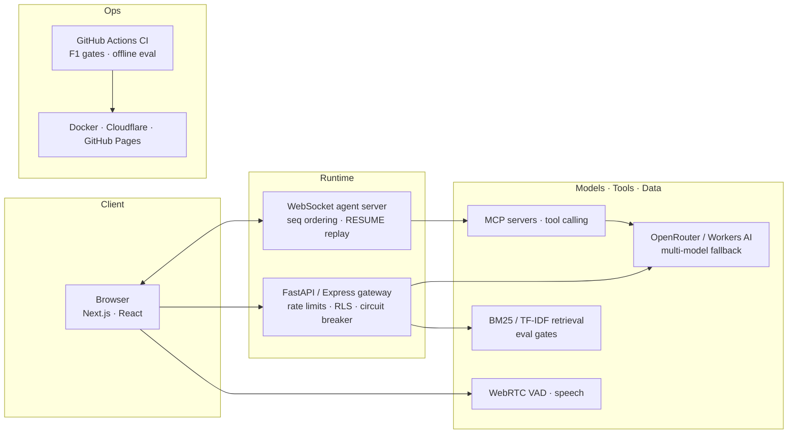

<!-- Profile README · Apple-clean · charcoal on #f5f5f7 / near-black · Oct 2026 -->

<p align="center">
  <picture>
    <source media="(prefers-color-scheme: dark)" srcset="https://raw.githubusercontent.com/mangeshraut712/mangeshraut712/main/banner-dark.svg?v=2026103105" />
    <source media="(prefers-color-scheme: light)" srcset="https://raw.githubusercontent.com/mangeshraut712/mangeshraut712/main/banner-light.svg?v=2026103105" />
    
  </picture>
</p>

> [!IMPORTANT]
> **Open to Software Engineer roles (Pune · Philadelphia · remote).** Portfolio systems: real-time speech VAD with an F1 gate, offline RAG eval, agents with tool calling and failure handling, and the full stack around them. Every number below links to the file or CI run that produced it — stub metrics are labelled stub.
>
> Fastest contact: [mbr63drexel@gmail.com](mailto:mbr63drexel@gmail.com)

<p align="center">
  <a href="https://mangeshraut712.github.io/mangeshrautarchive/"></a>
  <a href="https://www.linkedin.com/in/mangeshraut71298/"></a>
  <a href="https://www.instagram.com/mangesh_d_charming_guy/"></a>
  <a href="https://wa.me/917276819090"></a>
  <a href="https://x.com/mrcommando712"></a>
  <a href="mailto:mbr63drexel@gmail.com"></a>
</p>

<p align="center">
  <a href="https://github.com/sponsors/mangeshraut712"></a>
  <a href="https://buy.stripe.com/14A3cufGUgcV5ePfuA14401"></a>
  <a href="https://www.paypal.com/ncp/payment/LXNHJ5SUGNP82"></a>
  <a href="https://www.buymeacoffee.com/mangeshraut"></a>
</p>

---

### Start here — three systems, end to end

| Project | What it proves | Guardrails | Proof |
| --- | --- | --- | --- |
| [**ai-ml-portfolio**](https://github.com/mangeshraut712/ai-ml-portfolio) — speech VAD + RAG eval + NumPy ML from scratch | Measured VAD F1 gates (real audio + synthetic labels). Offline RAG/LLM eval with retrieval metrics; CI uses **stub** providers | Acceptance gate fails CI below fixed thresholds; eval falls back to stubs when keys are missing | [MODEL_CARD](https://github.com/mangeshraut712/ai-ml-portfolio/blob/main/labs/vad/MODEL_CARD.md) · [RESULTS](https://github.com/mangeshraut712/ai-ml-portfolio/blob/main/labs/llm-eval/RESULTS.md) |
| [**agent-console**](https://github.com/mangeshraut712/agent-console) — real-time agent debug UI over WebSocket | Streaming tokens, tool-call traces, protocol observability | Seq reorder + dedupe, `RESUME {last_seq}` replay, single-fire `TOOL_ACK`, chaos verify | [DECISIONS.md](https://github.com/mangeshraut712/agent-console/blob/main/DECISIONS.md) · [Pages replay demo](https://mangeshraut712.github.io/agent-console/) |
| [**Gravity-SaaS-Agent**](https://github.com/mangeshraut712/Gravity-SaaS-Agent) — multi-tenant agent SaaS starter | MCP client, skills engine, billing events, operator dashboard | Tier rate limits, Supabase RLS, circuit breaker, OpenRouter fallback. Channel adapters are **simulators**, not live Business API | [README](https://github.com/mangeshraut712/Gravity-SaaS-Agent#readme) · [CI](https://github.com/mangeshraut712/Gravity-SaaS-Agent/actions/workflows/ci.yml) |

**Reproduce the headline number** (Python 3.10–3.12, no API keys):

```bash
git clone https://github.com/mangeshraut712/ai-ml-portfolio && cd ai-ml-portfolio
make install && make verify-all      # mlfs tests + VAD FULL_PASS + offline LLM eval
```

---

### Engineering metrics — measured, with baselines and a failure case

<p align="center">
  <picture>
    <source media="(prefers-color-scheme: dark)" srcset="https://raw.githubusercontent.com/mangeshraut712/mangeshraut712/main/metrics-dark.svg?v=202610310542" />
    <source media="(prefers-color-scheme: light)" srcset="https://raw.githubusercontent.com/mangeshraut712/mangeshraut712/main/metrics-light.svg?v=202610310542" />
    
  </picture>
</p>

Headline on the card: VAD clean F1 **0.9569**, VAD p95 **~19 ms** (gate ≤100 ms), CI Python **3.10–3.12**. Detail the card does not show:

| Metric | Measured | Gate / baseline | Source |
| --- | ---: | ---: | --- |
| VAD exact F1, noisy — **known failure mode** | **0.7768** | ≥ 0.75 (clean ≥ 0.92) | [challenge_pass.py](https://github.com/mangeshraut712/ai-ml-portfolio/blob/main/labs/vad/challenge_pass.py) · [MODEL_CARD](https://github.com/mangeshraut712/ai-ml-portfolio/blob/main/labs/vad/MODEL_CARD.md) |
| VAD soft F1 | **0.8135** | ≥ 0.78 | same |
| RAG retrieval **(offline stub)** — TF-IDF Recall@5 · MRR · nDCG@5 | **1.000 · 0.981 · 0.986** | 40 gold QA + 15 adversarial on 10 FAQ docs. BM25-fusion stub Recall@3 **0.975**. Hallucination 0.000 = stub abstaining | [RESULTS.md](https://github.com/mangeshraut712/ai-ml-portfolio/blob/main/labs/llm-eval/RESULTS.md) (STUB, 2026-07-24) · [DATA_CARD](https://github.com/mangeshraut712/ai-ml-portfolio/blob/main/labs/llm-eval/DATA_CARD.md) |
| Stub cost / latency matrix | p95 ms and $/1k queries per **stub** provider | live path is `EVAL_LIVE=1`; CI never sets it | same RESULTS.md |
| CI run for `make verify-all` | green | — | [Sep 11, 2026](https://github.com/mangeshraut712/ai-ml-portfolio/actions/runs/34574401205) |

---

### Open-source contributions

**27 / 50 tracked-company GitHub PR merges** as of **2026-10-30 (UTC)**.<br>
Scoreboard: tip-15 (Apple · Meta · Anthropic · OpenAI · Netflix · Microsoft · Tesla · SpaceX/xAI · Samsung · LG · Walmart · JPMorgan · Amazon/AWS · Adobe · NVIDIA) **plus** Google · Moonshot/Kimi · Sarvam AI.<br>
The goal counts upstream PRs with GitHub `merged=true`; own repositories, duplicate records, and closed-unmerged PRs are excluded. Need **23 more** by **EOD 31 Oct 2026 IST**. Roojool and other non-allowlist orgs do not count.<br>
**14 [Meta Pyrefly](https://github.com/meta/pyrefly) CodeSync landings** on `main` are separately verified as of **2026-10-30 (UTC)**. Their associated GitHub PRs are closed with `merged=false`, so they are not included in the 27.

Live search sample: `author:mangeshraut712 is:pr is:merged -user:mangeshraut712 -user:dayx61 -org:Roojool` (then filter to the allowlist).

```text
27 / 50  ██████████▊░░░░░░░░░  54%
```

#### By organization (allowlist scoreboard)

| Org | GitHub merged | Focus |
| --- | ---: | --- |
| [Apple](https://github.com/apple/password-manager-resources) | 7 | Password-manager resources & schema |
| [Microsoft](https://github.com/microsoft) | 4 | hve-core + winget-pkgs + physical-ai-toolchain |
| [Adobe](https://github.com/adobe/react-spectrum) | 2 | React Aria / Spectrum (incl. ColorField Form validation) |
| [AWS Labs](https://github.com/awslabs/mcp) | 4 | MCP, Stickler & billing-cost fixes |
| [NVIDIA](https://github.com/NVIDIA/TensorRT-Model-Connect) | 4 | CUDA Python tests & TensorRT tooling/CI |
| [Sarvam AI](https://github.com/sarvamai/sarvam-ai-cookbook) | 2 | Cookbook CI |
| [OpenAI](https://github.com/openai/codex-security) | 1 | codex-security CLI guidance |
| [Google](https://github.com/google/sbsim) | 1 | sbsim BUILD cleanup |
| [Moonshot](https://github.com/MoonshotAI/kimi-code) | 1 | kimi-code models.dev fallback |
| [Samsung](https://github.com/Samsung/CredSweeper) | 1 | CredSweeper install-guide docs |
| [Meta Pyrefly](https://github.com/meta/pyrefly) | 0 | 14 accepted CodeSync landings on `main` (separate) |
| Anthropic · Netflix · Tesla · SpaceX/xAI · LG · Walmart · JPMorgan | 0 | — |

#### Selected Engineering Impact

- [AWS Labs Stickler #456](https://github.com/awslabs/stickler/pull/456) — Escaped formatted report-cell output and added regression coverage for the affected display paths.
- [Adobe React Spectrum #10863](https://github.com/adobe/react-spectrum/pull/10863) — Made `ColorField` inherit a parent `Form`’s `validationBehavior`, with regression coverage.
- [NVIDIA cuda-python #3241](https://github.com/NVIDIA/cuda-python/pull/3241) — Restored SIGINT handling in the keyboard-interrupt child test.

---

### More projects

Flagship systems stay in **Start here**. Everything else:

<p align="center">
  <picture>
    <source media="(prefers-color-scheme: dark)" srcset="https://raw.githubusercontent.com/mangeshraut712/mangeshraut712/main/projects-dark.svg?v=20261030-claims" />
    <source media="(prefers-color-scheme: light)" srcset="https://raw.githubusercontent.com/mangeshraut712/mangeshraut712/main/projects-light.svg?v=20261030-claims" />
    
  </picture>
</p>

**Also:** [**Actions Nurse**](https://github.com/mangeshraut712/actions-nurse) — Open Agent Hackathon 2026 Wildcard (submitted 28 Oct 2026 4:30 AM IST, [hub](https://hackathon.genai.works/submissions?hackathon_id=019fd164-82b9-7382-a536-d9093c576ed2)). CI triage agent: Rules + optional Gemma, Meterless H-MEM, Zetaris evidence. [submission stamp](https://github.com/mangeshraut712/actions-nurse/blob/main/docs/OPEN-AGENT-SUBMISSION.md).

**Also:** [**Asset Intelligence Copilot**](https://github.com/mangeshraut712/asset-intelligence-copilot) — FlytBase challenge entry (AI Hackers Collective × Hacktoberfest 2026 Hack Day). Chat copilot for oil-field operators: deterministic tools compute numbers, answers cite record IDs and SOP passages, Gemma 4 for planning/phrasing. Local; MIT.

---

<details>
<summary><b>Architecture</b> — patterns across these projects</summary>



</details>

<details>
<summary><b>AI engineering stack</b> — every claim points at a dependency file</summary>

<p align="center">
  <picture>
    <source media="(prefers-color-scheme: dark)" srcset="https://raw.githubusercontent.com/mangeshraut712/mangeshraut712/main/stack-dark.svg?v=20261030-claims" />
    <source media="(prefers-color-scheme: light)" srcset="https://raw.githubusercontent.com/mangeshraut712/mangeshraut712/main/stack-light.svg?v=20261030-claims" />
    
  </picture>
</p>

The card lists tools I use. **Only the dependency manifests below are claims about these repos.**

| Stack claim | Source |
| --- | --- |
| NumPy · webrtcvad · rank-bm25 · scikit-learn | [ai-ml-portfolio/pyproject.toml](https://github.com/mangeshraut712/ai-ml-portfolio/blob/main/pyproject.toml) |
| Next.js 16.4.3 · React 19.1 · Turbopack | [agent-console/package.json](https://github.com/mangeshraut712/agent-console/blob/main/package.json) |
| Next.js 15.5 · React 19.2 · Cloudflare Workers AI | [Hindai/package.json](https://github.com/mangeshraut712/Hindai/blob/main/package.json) · [workers/hindai-gemma](https://github.com/mangeshraut712/Hindai/tree/main/workers) |
| Next.js 16.4 dashboard · Express gateway · Supabase | [Gravity-SaaS-Agent/apps](https://github.com/mangeshraut712/Gravity-SaaS-Agent/tree/main/apps) |
| FastAPI | [mangeshrautarchive/requirements.txt](https://github.com/mangeshraut712/mangeshrautarchive/blob/main/requirements.txt) · [career-agent-pro/backend](https://github.com/mangeshraut712/career-agent-pro/blob/main/backend/requirements.txt) |
| Sarvam SDK | [Realtime_Speech_Captioning/requirements.txt](https://github.com/mangeshraut712/sarvam-ai-cookbook/blob/main/examples/Realtime_Speech_Captioning/requirements.txt) |

</details>

<details>
<summary><b>Now</b> — what I'm building this quarter</summary>

<p align="center">
  <picture>
    <source media="(prefers-color-scheme: dark)" srcset="https://raw.githubusercontent.com/mangeshraut712/mangeshraut712/main/focus-dark.svg?v=20261030-claims" />
    <source media="(prefers-color-scheme: light)" srcset="https://raw.githubusercontent.com/mangeshraut712/mangeshraut712/main/focus-light.svg?v=20261030-claims" />
    
  </picture>
</p>

</details>

<details>
<summary><b>Principles, writing, trajectory</b></summary>

**Engineering principles**

- Measure everything; ship the gate with the number
- Local-first whenever possible; CI must not depend on a live API
- Reliability over novelty — an agent with guardrails beats a flashier one without
- AI should augment, not obscure, the system
- Developer experience matters; simple systems scale better

Details: [INTERVIEW_NOTES.md](https://github.com/mangeshraut712/ai-ml-portfolio/blob/main/INTERVIEW_NOTES.md)

**Writing**

- [Technical writings RSS](https://mangeshraut712.github.io/mangeshrautarchive/rss.xml)

**Trajectory**

<p align="center">
  <picture>
    <source media="(prefers-color-scheme: dark)" srcset="https://raw.githubusercontent.com/mangeshraut712/mangeshraut712/main/trajectory-dark.svg?v=2026102810" />
    <source media="(prefers-color-scheme: light)" srcset="https://raw.githubusercontent.com/mangeshraut712/mangeshraut712/main/trajectory-light.svg?v=2026102810" />
    
  </picture>
</p>

<p align="center">
  <a href="https://github.com/mangeshraut712?tab=overview&from=2021-01-01&to=2026-12-31">Contribution graph</a>
  ·
  <a href="https://github.com/mangeshraut712/mangeshraut712/blob/main/data/github-snapshot.json">yearly snapshot JSON</a>
</p>

</details>

